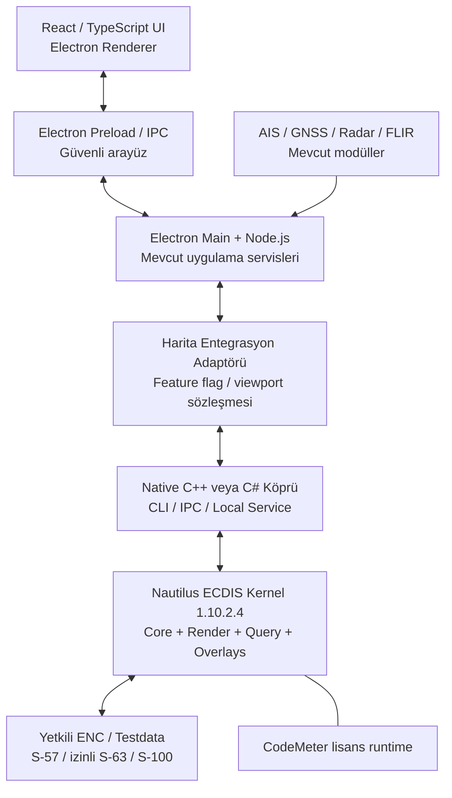

# IRBIS — Teledyne SevenCs Nautilus Kernel Entegrasyonu

> **Cursor / AI geliştirme ajanı için proje devir dokümanı**  
> **Son durum:** 5 Kasım 2026  
> **Belge sürümü:** 1.0  
> **Proje:** IRBIS — IRMARINETECH denizcilik harita, navigasyon ve izleme masaüstü uygulaması  
> **Ana hedef:** Mevcut Electron + React + TypeScript uygulamasını koruyarak profesyonel ENC harita motoru olarak Teledyne SevenCs Nautilus ECDIS Kernel SDK'yı entegre etmek.

---

## 0. CURSOR'A ÖNEMLİ TALİMAT — ÖNCE OKU

Bu dosya mevcut projeye ilişkin **iş bağlamını, doğrulanmış durumu, teknik kararları ve yapılacak işleri** aktarır. Geliştirme sırasında:

1. **Var olan IRBIS projesini yeniden oluşturma.** İlk önce repoyu, `package.json`, Electron main/preload, React harita bileşeni, Node.js servisleri, mevcut MapLibre entegrasyonu ve AIS/radar/kamera/NMEA modüllerini incele.
2. **Sadece harita çekirdeği katmanını kademeli değiştir.** Mevcut UI, modüler mimari, cihaz entegrasyonları, ayarlar ve işlevler korunacak. Kırıcı refactor yapma.
3. **Gerçek API'yi görmeden Nautilus sınıf/metot isimleri uydurma.** SDK'nın `include/`, `examples/`, `cmake/` ve `documentation/html/index.html` içeriği kaynak kabul edilecek. Bu belge mimari/plan belgesidir, programlama API referansı değildir.
4. Lisans aktif görünüyor; ancak **`CheckRegistration` örneği henüz derlenip çalıştırılarak doğrulanmadı**. Aktivasyonu uygulama seviyesinde ayrıca test et.
5. **ChartServer şu ana kadar kullanıcıya teslim edilmiş değil.** Teslim edilen ve etkinleştirilen ürün **Nautilus ECDIS Kernel SDK**. ChartServer isteği ayrı takip edilebilir.
6. **Gizli/ticari dosyaları commit etme:** SevenCs SDK binary'leri, lisans dosyaları, `.WibuCmLIF` / `.WibuCmRaC` / `.WibuCmRaU`, üretici dokümanları, ticari fiyatlar, S-63 izinleri ve korumalı ENC veri kümeleri herkese açık repoya girmeyecek.
7. Her aşamada **kanıta dayalı rapor ver**: ne bulundu, ne çalıştı, hangi hata alındı, sonraki somut işlem ne. Henüz yapılmayan işleri tamamlanmış gibi yazma.
8. Önce **çalışan küçük PoC**, sonra IRBIS içine entegrasyon. Electron ile Vulkan/OpenGL ortak texture entegrasyonunu doğrudan mümkün varsayma.
9. Yeni harita katmanını **feature flag / adapter** ile devreye al. Mevcut MapLibre bileşeni geçişte fallback veya ayrı altlık için korunabilir; aniden kaldırılmasın.
10. Üreticiyle yazışma hazırlanacaksa şirket adı **IRMARINETECH** (bitişik); yazılımın iç adı **IRBIS** ürün adı olarak dış iletişimde belirtilmesin. Toplantı önermeden yazılı teknik yanıt istenmesi tercih edilmişti.

---

## 1. PROJE NEDİR, HEDEFİMİZ NE?

IRMARINETECH bünyesinde geliştirilen IRBIS, Windows üzerinde çalışan profesyonel bir denizcilik harita ve durumsal farkındalık uygulamasıdır. Amaç, Simrad/Garmin tarzı chartplotter deneyiminin PC'de; modern bir kullanıcı arayüzü ve farklı sensörlerle bir arada sunulmasıdır. İlk öncelikler arasında liman/kıyı güvenliği ve deniz trafiği izleme vardır; zaman içinde tekne/seyir navigasyonu ve gelişmiş rota fonksiyonlarına büyümesi hedeflenir.

### Mevcut / önceden geliştirilmekte olan teknoloji seti

- Masaüstü kabuk: **Electron**.
- Arayüz: **React + Vite + TypeScript**, gerektiğinde JavaScript.
- Masaüstü/cihaz/servis katmanı: **Node.js / Electron main process**.
- Önceki harita yaklaşımı: **MapLibre GL JS** ve/veya yerel tile/harita servisleri.
- İlgili modüller: GNSS/NMEA 0183, AIS, radar verisi/kontrol çalışmaları, FLIR kameralar/görüntüleme/kontrol, harita üzerindeki etkileşimler. Her birinin bugünkü uygulama durumunu **repo incelemesi** belirleyecek; bu liste tümünün üretimde tamamlandığını iddia etmez.
- Hedef platform: **Windows x64**, çoğunlukla **offline veya izole ağ**.
- Ana uygulama kullanıcı arayüzü Türkçe, modern, sade; geliştirilen mevcut tasarım korunacak.

### Yeni hedef

Deniz haritasını sıfırdan S-52/S-63/S-100 uyumlu render etmeye uğraşmak yerine **Teledyne SevenCs Nautilus ECDIS Kernel**'in aşağıdaki yeteneklerinden yararlanmak:

- S-57 ENC görüntüleme ve S-52 portrayal.
- İzinli/şifreli S-63 ENC verisini içe aktarma/yönetme.
- S-101 ve diğer uygun S-100 veri ürünleri; kesin aktif modüller lisans + SDK ile doğrulanacak.
- Pan, zoom, rotation, projection, koordinat dönüşümleri.
- Harita objesi/özellik/derinlik sorguları (`PickReport`, `DangerHighlight` vb.).
- Gerekirse AIS, ARPA, rota ve özelleştirilmiş coğrafi overlay mekanizmaları.
- Yerel/offline kullanım ve ticari sürümde lisanslı paketleme.

**Yazılım bütünüyle C++/C#'a taşınmayacak.** Gerekli native katman yalnızca harita/SDK erişimini sağlayacak. İlk PoC'de mümkün olan en az değişiklik hedeflenecek.

---

## 2. TELEDYNE SEVENCS İLE YAZIŞMA — KRONOLOJİ

### 2.1 İlk teknik görüş alışverişi (Ekim 2026)

- IRMARINETECH, S-57 / Türkiye S-63 ENC, gelecekte S-100, Windows/offline kullanım ve Electron/React tabanlı özel UI için **Nautilus Kernel SDK ile Nautilus ChartServer** seçeneklerini araştırdı.
- 27 Ekim 2026 tarihli ayrıntılı teknik soru listesi hazırlandı ve SevenCs'e iletildi.
- Üretici Bryan ve Stefan ile yazışmalar yürütüldü; yazılı yanıt ve değerlendirme erişimi talep edildi.
- SevenCs soruların büyük çoğunluğunu yanıtladı; birkaç noktada teknik ekipten ayrıca açıklama gerektiğini belirtti.

### 2.2 Üreticinin kesinleşen ürün ayrımı

| Konu | Nautilus ECDIS Kernel SDK | Nautilus ChartServer |
|---|---|---|
| Temel rol | Geliştiricinin kendi ENC/navigasyon uygulamasını oluşturduğu **SDK** | Nautilus SDK üzerine geliştirilmiş **hazır harita sunucusu** |
| Mevcut UI'yi özelleştirme | Daha yüksek esneklik | Web/OGC servis istemcisi yaklaşımı |
| Native C++ / C# | C++ arayüzü, C# wrapper olduğuna dair üretici yanıtı | Normalde WMS/servis/API tüketimi |
| Offline tek PC | Uygun | Yerel servis olarak çalışabileceği doğrulandı |
| IRBIS'in gelecekteki gelişmiş navigasyon hedefi | **Üreticinin öncelikli önerisi** | Sadece arka plan ENC + AIS katmanları için daha pratik olabilir |
| Ücretsiz deneme | **60 gün** | **30 gün** |
| Teslim durumu (05.11.2026) | **İndirildi, kuruldu, CodeMeter aktive edildi** | **Henüz alındığı doğrulanmadı** |

Bryan'ın özeti: Kernel kendi uygulamanızı kurmanıza yarar; ChartServer SDK üzerinde hazırlanmış hazır bir ürün; tercih **make-or-buy** kararıdır. Her ikisinin değerlendirilmesi mümkündür. Ancak ikisini aynı anda üretim mimarisinde kullanmak özel gerekçe yoksa gereksiz karmaşıklık getirebilir.

### 2.3 Teknik soru-cevap belgesinden kritik netlikler

- **Kernel, ana pencerenin tümünü sahiplenmek zorunda değil:** hedef bir widget, image/surface gibi render yöntemleri açıklanıyor.
- **Render seçenekleri:** Cairo, OpenGL, Vulkan; offscreen image; Qt `QImage` / `QPixmap`; Vulkan External Target / `VkImage` bilgisi belgelenmiş.
- **Electron/React entegrasyonu mümkün yaklaşım:** native **C++ / C# köprü veya yerel servis** düşünülebilir. **Ancak üreticinin resmî Electron/React referans mimarisi yok.**
- **MapLibre kararı:** SevenCs ana ENC viewport'u Nautilus'un render etmesini öneriyor. MapLibre'ı overlay/etkileşim katmanı olarak kullanmanın uygulanabilirliği özel mimari ve performans testine bağlı.
- **ENC:** S-57/S-63 + lisanslı izinler; chart library, datum/koordinat, feature query, pick report, update yönetimi.
- **Türkiye S-63:** geçerli izin ve lisanslarla işlenebilir. Doğrudan S-63 OEM çözümü için IHO anlaşması, Manufacturer ID (M-ID), Manufacturer Key (M-Key) gibi gereklilikler doğabilir. Bu yükümlülük SDK'nın otomatik kaldırdığı bir konu değil.
- **Offline:** izinler ve lisanslar sağlandıktan sonra internet bağlantısı olmadan kullanılabilir.
- **S-100:** S-101/S-102/S-104/S-111 modüllerinden söz edildi; S-57 ile S-100'ü birlikte kullanmaya yönelik 'dual-fuel' yaklaşımı var. Kullanılabilirlik, verinin test/üretim niteliği, sürüm ve runtime modülleri ayrıca teyit edilecek.
- **Overlay:** AIS, ARPA, Own Ship, rotalar, waypoint, radar akışı ve özel geospatial katman örnekleri var. FLIR'a özgü hazır footprint olmadığı belirtildi; özel overlay olarak geliştirilebilirliği test edilmeli.
- **Dağıtım:** CodeMeter runtime + Nautilus kitaplıkları ve gerektiğinde Chart Installer; runtime lisansı her kurulan son sistem için gerekli olabilir.
- **Üretim lisansları:** perpetual runtime seçeneği; bakım yenilenmezse yüklenmiş sürüm çalışabilir, destek/güncellemeler farklılaşır. Grafik/SDK lisansı ile ENC veri kullanım hakkı aynı şey değildir.

### 2.4 Deneme paketinin gönderilmesi (4–5 Kasım 2026)

SevenCs Support tarafında **Tejomanvitha Bathula**, Stefan'ın talebiyle **Nautilus ECDIS Kernel evaluation** paketinin indirme bağlantısını ve kurulum talimatını gönderdi.

Gönderilen pakette kullanıcının ekran görüntülerinde şu öğeler görüldü:

- `nautilusecdiskernel-1.10.2.4-windows` (Windows installer)
- `nautiluschartinstaller-1.11.2.4-windows` (ayrı Chart Installer)
- `NautilusInstallationGuide1.10.2.pdf`
- `NautilusReleaseNotes1.10.2.pdf`

> **DİKKAT:** `nautiluschartinstaller` **ChartServer değildir**. Bu, harita verilerini Nautilus sistemine kurmak/yönetmek için ayrı yardımcı araçtır. ChartServer'ın 30 günlük değerlendirme paketiyle karıştırılmamalı.

### 2.5 Lisans süreci ve teyit edilen son durum

1. SDK indirilip Windows bilgisayara kuruldu.
2. Wibu **CodeMeter Control Center** kurulmuş/çalışıyor.
3. SDK `CodeMeter` klasöründeki **`SevenCs-CmAct-VM.WibuCmLIF`** içeri aktarıldı.
4. CodeMeter'da **SevenCs CmContainer (VM)** oluşturuldu; önce `Empty license container` durumu görüldü.
5. `License Update → Create license request` akışıyla **`.WibuCmRaC`** lisans istek dosyası üretildi ve SevenCs'e e-postayla gönderildi.
6. SevenCs Support, karşılık olarak **`.WibuCmRaU`** aktivasyon dosyasını iletti.
7. Kullanıcı bu güncellemeyi CodeMeter'a import etti. Son ekran görüntüsünde **`Status: License activated`** ve **`CodeMeter service is running`** görünüyor.
8. **Henüz** `CheckRegistration.exe` ile uygulama düzeyinde lisans doğrulaması yapılmadı.

Bu durum **lisans aktivasyonu tamam** demektir; tüm SDK örneklerinin başarılı derlendiği veya bütün modüllerin doğrulandığı anlamına gelmez. Lisansın hangi tarihte başlayıp sona erdiğini CodeMeter/WebAdmin'de kontrol et; belgeye tahmini tarih yazma.

---

## 3. BİLGİSAYARDAKİ GERÇEK KURULUM DİZİNİ

Kullanıcı SDK'yı varsayılan `C:` yerine **`K:` diskine** kurmuştur:

```text
K:\SevenCs\Nautilus\1.10.2.4\
```

Kurulu klasörler kullanıcı ekran görüntüsünde **görüldü**:

```text
K:\SevenCs\Nautilus\1.10.2.4\
├── bin\               # DLL ve hazır araçlar
├── cmake\             # Nautilus CMake entegrasyon dosyaları
├── CodeMeter\         # Lisans konteyneri başlangıç dosyası vb.
├── documentation\     # Programming Guide, Deployment Guide, Doxygen
├── examples\          # Kaynak kodlu örnekler
│   ├── console\
│   │   ├── CheckRegistration\
│   │   ├── ENCStatusReport\
│   │   ├── ImportData\
│   │   ├── PrintChart\
│   │   ├── RouteCheck\
│   │   ├── ShowCell\
│   │   ├── VulkanTest\
│   │   └── WorldMap\
│   ├── portrayal\
│   └── CMakeLists.txt
├── include\           # C++ public headers
├── lib\               # Link kitaplıkları
├── licenses\
├── plugins\
├── runtime\
├── src\               # Qt painter/widget kaynakları
└── testdata\          # SDK test verileri; içerik incelenecek
```

**Kullanıcı `examples/console/CheckRegistration` klasörünü açtı.** İçinde `main.cpp` ve `CMakeLists.txt` olduğu görüldü. **Dosyalar henüz derlenmedi**; `CheckRegistration.exe` henüz çalıştırılmadı.

SDK'nın kurulum kılavuzuna göre ilgili dokümantasyon genellikle şu dizinlerdedir (gerçek kurulu içeriği yerinde doğrula):

```text
K:\SevenCs\Nautilus\1.10.2.4\documentation\pdf\NautilusProgrammingGuide.pdf
K:\SevenCs\Nautilus\1.10.2.4\documentation\pdf\NautilusDeploymentGuide.pdf
K:\SevenCs\Nautilus\1.10.2.4\documentation\pdf\NautilusBackgroundInformation.pdf
K:\SevenCs\Nautilus\1.10.2.4\documentation\html\index.html
```

Ürünün genel kütüphane adları (gerçek dosya uzantıları, konum ve sürüm varyantlarını kontrol et):

- `NautilusCore`
- `NautilusCairo`
- `NautilusGL`
- `NautilusVk`
- `NautilusSQL`
- `NautilusPQ`

**Önemli:** Kurulum kılavuzlarındaki eski `C:\SevenCs\...` örneklerini körü körüne kullanma. Bizde kök dizin `K:\SevenCs\Nautilus\1.10.2.4`.

---

## 4. GÖNDERİLMİŞ / KULLANICI TARAFINDAN SAĞLANACAK BELGELER

Cursor'a kullanıcı tarafından ayrıca verilecek kaynakları incele:

| Dosya | İçerik | Kullanım |
|---|---|---|
| `Nautilus_Technical_Evaluation_Answered.docx` | IRMARINETECH'in 36 sorusuna SevenCs yanıtları | Ürün seçimi, render, lisans, özel UI ve mimari kararları |
| `Nautilus_ProductInformation_1.8_Mar2025.pdf` | Mart 2025 Kernel SDK ürün bilgisi | Genel özellikler, modüller, lisans yaklaşımı; **daha eski sürüm belgesi** |
| `TeledyneSevenCs-NautilusChartServer-ProductInformation.pdf` | Haziran 2026 ChartServer ürünü | ChartServer karşılaştırması; ürünün kurulu olduğunu göstermez |
| `NautilusInstallationGuide1.10.2.pdf` | Kurulum, CodeMeter, örnek proje derleme | **Mevcut kurulum için öncelikli referans** |
| `NautilusReleaseNotes1.10.2.pdf` | 1.10.x sürüm değişiklikleri | SDK özellikleri/hata düzeltmeleri ve sürüm uyumu |
| SDK kurulum içindeki `documentation/html/index.html` | Doxygen API belgeleri | **Sınıf ve fonksiyonlar için birincil kaynak** |
| SDK kurulum içindeki `documentation/pdf/NautilusProgrammingGuide.pdf` | SDK programlama açıklamaları | Çalışan entegrasyon ve render yöntemleri |
| SDK `examples/**` | Gerçek örnek C++ kaynak kodu | **PoC geliştirme için birincil kaynak** |

Belgeler SevenCs tarafından **gizli / ticari açıdan hassas** olarak işaretlenmiş olabilir. Yerel çalışma alanında incele; lisans koşullarını kontrol etmeden yayımlama.

### Doküman/sürüm farklarına dikkat

- Mart 2025 ürün broşüründe SDK sürümü **1.8** anlatılıyor; gerçekte yüklenen SDK **1.10.2.4**.
- Haziran 2026 ChartServer bilgi dokümanındaki ürün/sürüm modülleri ile soru-cevap belgesindeki ifadeler birebir aynı olmayabilir.
- 1.10.2 Release Notes içindeki standartlar tablosunda sürüm başlığından farklı bir kernel sürümü ifadesi olabilir; *belge içindeki ifade/sürüm tutarsızlıklarını* işletim ortamında doğrulamadan yorumlama.
- Release Notes'ta bir standardın listelenmesi, o modülün mevcut evaluation lisansında etkin ya da ticari kullanımının koşulsuz olduğu anlamına gelmez.

---

## 5. ÖNCELİKLİ ÇALIŞMA PLANI — ÖNCE SDK'YI DOĞRULA

### Aşama A — Mevcut sistem keşfi

1. IRBIS proje kökünü ve mimarisini incele.
2. Var olan harita bileşenlerini, state yönetimini, veri katmanlarını, Electron main/preload IPC yapısını tespit et.
3. Sistemde Visual Studio 2022 C++ Build Tools (`MSVC x64`), CMake ve Qt kurulumlarını doğrula.
4. `K:\SevenCs\Nautilus\1.10.2.4` altındaki `examples/`, `include/`, `lib/`, `bin/`, `cmake/`, `testdata/`, `documentation/` yapısını sırayla incele.
5. `CheckRegistration/CMakeLists.txt` ile `main.cpp` içeriğini oku. Nautilus'un doğru şekilde nasıl `find_package` edildiğini çöz.
6. CodeMeter'ın çalıştığını kontrol et. **Mevcut lisans dosyalarını taşıma, değiştirme veya silme.**

### Aşama B — `CheckRegistration` derlemesi (ilk gerçek test)

**Önkoşullar:** Windows x64; Visual Studio 2022 C++ toolchain; CMake. SDK'nın Windows için x64/MSVC örnekleri kullanılır.

Önce kaynak kodu ve CMake dosyasını oku. Uygunluğu doğrulandıktan sonra terminalde örnek başlangıç:

```powershell
$SDK = 'K:\SevenCs\Nautilus\1.10.2.4'

# Dosyaları kontrol et
Get-ChildItem "$SDK\examples\console\CheckRegistration"
Get-Content "$SDK\examples\console\CheckRegistration\CMakeLists.txt"

# Kurulu araçları kontrol et
cmake --version
Get-Command cl.exe -ErrorAction SilentlyContinue

# x64 VS2022 hedefiyle ayrı build dizini oluştur
cmake -S "$SDK\examples\console\CheckRegistration" `
  -B "$SDK\build\CheckRegistration" `
  -G 'Visual Studio 17 2022' -A x64

cmake --build "$SDK\build\CheckRegistration" --config Release
```

**Notlar:**

- `cl.exe` normal PowerShell ortamında görünmeyebilir; VS2022 Developer PowerShell / x64 Native Tools Command Prompt kullan.
- CMake, Nautilus paketini bulamazsa önce `K:\SevenCs\Nautilus\1.10.2.4\cmake` altındaki gerçek `*Config.cmake` / `Find*.cmake` içeriklerini ve örnek `CMakeLists.txt` dosyasını incele. Gerektiğinde `CMAKE_PREFIX_PATH` / `CMAKE_MODULE_PATH` ayarla; **belgelenmemiş paket adlarını varsayma**.
- SDK sürümünün yüklediği DLL'lerin PATH'de tanımlı olduğunu ve x64 yapılandırma kullanıldığını kontrol et.
- Başarılı derlemeden sonra `.exe` konumunu gerçek build çıktısından tespit et ve çalıştır. `CheckRegistration` çıktısını **gizli lisans tanımlayıcıları/sırlar maskelenmiş biçimde** kaydet.
- Compile/runtime hatası olursa hata mesajını ve gerekli bağlamı raporla. Lisans mekanizmasını atlatmaya çalışma.

**Başarı kriteri:** `CheckRegistration` örneği başlar ve SDK ile lisans durumunun geçerli olduğunu somut çıktı/log üzerinden gösterir.

### Aşama C — İlk ENC görüntüsü / temel render

Lisans kontrolünden sonra şu sırayla ilerle:

1. `testdata` içindeki gerçekten mevcut açık örnek verileri listele ve uygun veri formatlarını belirle.
2. `console/ShowCell` veya `console/WorldMap` ile en basit render testini dene.
3. `console/PrintChart` ile haritayı resim olarak dışarı render etme akışını incele. Bu, Electron'a ilk minimal bağlantı için en güvenli başlangıç olabilir.
4. `portrayal/ChartViewer` ile interaktif harita görüntüsü, pan ve zoom çalıştır.
5. `portrayal/PickReport` ile obje/öznitelik sorgulamasını doğrula.
6. `portrayal/DynamicOverlays` ve `AISOverlay` örneklerini çalıştır.
7. `portrayal/SplitView`, `Routes`, `DangerHighlight` ve `ARPAOverlay` sonraki aşamada.

**Qt bağımlılığı:** Kurulum kılavuzu GUI örnekleri için **Qt 5.15 veya üzeri** ve **MSVC 2022 64-bit** varyantını önerir; Qt MinGW kit ile Nautilus Windows binary'lerinin uyumsuz olabileceğini özellikle belirtir. `Qt Image Formats` eklentisi önerilmiştir. GUI PoC için Qt kur ama **IRBIS'in React UI'sini Qt'ye taşıma**.

**Önemli:** `nautiluschartinstaller-1.11.2.4-windows` henüz kurulmuş değil. `ImportData`, resmi S-57/S-63 setleri ve chart library testlerinde ihtiyaç/yöntem kurulum kılavuzuyla doğrulanıp gerektiğinde kurulsun. Chart Installer'ı **ChartServer ürünü** sanma.

### Aşama D — Demo'yu IRBIS'in mevcut arayüzüyle konuştur

İlk hedef, mevcut React ekranının kontrol edebildiği **en küçük bağımsız çalışan native harita PoC'si**. Deneyleri aşamalara böl:

#### D1. En düşük risk: tek kare görüntü / CLI

- Nautilus C++ örneği üzerinden belirli bir extent/zoom için görüntü üreten minimal yardımcı araç / süreç.
- Electron main process veya Node.js bu helper'ı kontrollü olarak çağırır.
- React `NautilusMapViewport` PoC bileşeninde görüntüyü gösterir.
- CLI parametreleri / stdin/stdout protokolü gerçekten uygulanabilirse kullanılır.
- **Limit:** Bu yaklaşım yüksek FPS, akıcı pan/zoom ve sürekli overlay için tek başına yeterli olmayabilir. Yalnızca API ve görüntü üretimi doğrulama adımıdır.

#### D2. Yerel servis veya IPC kontrollü interaktif harita

- Native katmanda pencere durumu tutulur: center, bbox, scale, rotation, size, DPI, palette.
- React/Electron istek yolları: `initialize`, `setViewport`, `pan`, `zoom`, `rotate`, `pickFeature`, `setDisplayOptions`, `renderFrame` gibi **önerilen uygulama-seviyesi komut adları**; bunlar Nautilus'un gerçek SDK metodları değildir.
- IPC/localhost API veya named pipes kullanılabilir; mevcut Electron güvenlik ve process mimarisiyle uyum kontrolü yap.
- İlk turda kontrollü image buffer/PNG teslimi değerlendir; sonra performans ölçümüne göre optimize et.
- Coğrafi koordinat dönüşümünü tek bir otorite üzerinden yönet; UI ve native tarafın ayrı projeksiyon veya rotation hesapları yaparak kaymasına izin verme.

#### D3. Uzun vadeli hedef: yüksek performanslı native render entegrasyonu

- SDK docs üzerinden host widget, offscreen image, OpenGL/Vulkan, external target yöntemlerini karşılaştır.
- Vulkan `VkImage`'ın Electron renderer/WebGL veya Chromium compositing ile **otomatik olarak paylaşılabileceğini varsayma**. GPU texture handle paylaşımı, device/context uyumu, senkronizasyon ve kopyalama gereksinimleri ayrı prototip gerektirir.
- `HWND` child window gömme, native addon, offscreen buffer, shared memory/frame transport gibi seçenekleri teknik zorluk ve Windows/Electron uyumluluğuyla değerlendir.
- Eğer native pencere embed işlemi Electron sürümü yüzünden problemliyse bunu açıkça belgele ve çalışan alternatifte kal.

### Aşama E — Harita katmanları ve etkileşim

Bağımsız harita PoC doğrulandıktan sonra mevcut veri kaynaklarıyla entegrasyon:

1. AIS hedefleri: konum, heading/COG, hız, seçili hedef, vessel track; önce mock data ile çalıştır.
2. Radar: gerçek cihaza entegrasyondan önce overlay georeferencing, ölçek ve rotation testleri.
3. GNSS/NMEA: own-ship güncellemeleri ve koordinat tutarlılığı.
4. FLIR kamera: mevcut cihaz kontrol modülü korunur; kamera konumu/yönü/FOV mümkün olduğunda özel coğrafi overlay olarak eklenir. **SDK'da FLIR footprint hazır olduğu iddia edilmez.**
5. Route/waypoints, ölçüm (VRM/EBL), güvenlik alanları, renk paleti, kartografik ayarlar.
6. Birden fazla viewport / split view, gün/gece modu ve cihaz performansı.

Sıralama repo içindeki modül olgunluğuna ve test ekipmanına göre revize edilebilir.

---

## 6. ÖNERİLEN HEDEF MİMARİ



> Bu **önerilen uygulama mimarisidir**. Üreticinin doğruladığı kısım: C++/C# arayüzleri, render seçenekleri ve Electron/React ile böyle bir köprü yaklaşımının teknik olarak değerlendirilebilir olması. Yukarıdaki akışın spesifik IPC/texture/port tasarımı henüz uygulama üzerinde doğrulanmamıştır.

### Katman sorumlulukları

| Bileşen | Sorumluluk | Değişiklik |
|---|---|---|
| React/Vite/TS | UI, paneller, harita kullanıcı etkileşimleri | **Korunur**, adaptör bağlanır |
| Electron main/preload | native süreç yaşam döngüsü, güvenli IPC, uygulama packaging | **Korunur**, modül eklenir |
| Node.js servisleri | cihaz/sensör haberleşmesi, durum ve log yönetimi | **Korunur** |
| `MapEngineAdapter` (öneri) | Nautilus ve mevcut MapLibre arasında geçiş; viewport API | **Yeni** |
| Nautilus native bridge | SDK çağrıları, frame/overlay/nesne sorguları | **Yeni** |
| Nautilus SDK / CodeMeter | ENC işleme, render, lisans kontrolü | **Harici ticari bağımlılık** |
| Mevcut MapLibre | Geçiş fallback'i veya bazı altlıklar | Test bitene kadar kaldırma |

### Önerilen TypeScript soyutlama sözleşmesi (Nautilus API değildir)

```ts
export type GeoPosition = { longitude: number; latitude: number };
export type MapViewportState = {
  center: GeoPosition;
  widthPx: number;
  heightPx: number;
  rotationDeg: number;
  scale?: number;
};

export interface MapEngineAdapter {
  initialize(): Promise<void>;
  setViewport(viewport: MapViewportState): Promise<void>;
  pickFeature(screenX: number, screenY: number): Promise<unknown[]>;
  setPalette(palette: 'day' | 'dusk' | 'night'): Promise<void>;
  dispose(): Promise<void>;
}
```

Bu sözleşme **ön taslak**; repo mimarisi, gerçek SDK örnekleri ve koordinat/ölçek temsili incelenince kesinleştirilecek. Native kodu bu sözleşmeye uydurmak için SDK davranışını zorlamaya çalışma.

---

## 7. NATIVE KÖPRÜ: C++ MI C# MI?

- **C++:** Nautilus'un ana native arayüzüne en yakın seçenek; SDK örnekleri C++ ile sağlanıyor. İlk PoC için **tercih edilen başlangıç**.
- **C#:** Üretici C# wrapper olduğunu belirtiyor. Bilgisayarda gerçekten hangi wrapper/assembly ve örneklerin teslim edildiğini `documentation`, `bin`, `examples` üzerinden doğrula. C# ile Windows hizmet/IPC geliştirmesi kolaylaştırılabilir.
- **Sadece JS/TS:** Nautilus **Kernel için belgelenmiş doğrudan JS API'si teyit edilmedi**. Native bridge olmadan Kernel'in her işlevine erişebileceğimiz varsayılmamalı. Buna karşılık gelecekte ChartServer verilirse JS/HTTP servis tüketimi denenebilir.
- **Qt:** Verilen C++ GUI örneklerinin bağımlılığıdır. Kullanıcı arayüzünü Qt'ye taşıma kararı değildir.

İlk adımda `CheckRegistration`, `ShowCell` ve `PrintChart` üzerinden C++ araçlarla yol açılması en az riskli senaryodur.

---

## 8. ENC / S-63 LİSANSLAMA SINIRLARI

- Testin ilk aşamasında SDK `testdata` veya yeniden dağıtımına izin verilen açık örnek harita verilerini kullan.
- Kullanıcının Türkiye S-63 veri seti ayrıca mevcut olabilir; **geçerli izinler/Cell Permits/User Permit/Manufacturer Key ve chart-data lisansı** olmadan şifre çözmeye veya ithal etmeye kalkma.
- S-63 şifresini/korumayı atlatan kod yazma. Sağlayıcının meşru iş akışını takip et.
- Lisans aktivasyonu için CodeMeter kullanılıyor. CmAct lisans cihaz/VM koşullarına bağlı olabilir; geliştirme ortamının disk/VM özelliklerini rastgele değiştirme.
- SDK binary dosyaları ve ticari evraklar geliştirici makinede kalmalı; CI/CD ve dağıtım aşamasında ayrıca SevenCs sözleşmesi incelenecek.
- Bu geliştirme **ECDIS tip sertifikalı bir ürün yaratıldığını** göstermez. Yalnızca SDK'nın uygun standart desteği olabilir; sertifikasyon ayrı süreçtir.

---

## 9. PERFORMANS VE DOĞRULAMA KRİTERLERİ

Aşağıdaki değerler **hedef değil ölçülecek metriklerdir**; sabit FPS/latency taahhüdü değildir.

| Test | Nasıl doğrulanacak |
|---|---|
| Lisans kontrolü | `CheckRegistration` çalışıyor, CodeMeter runtime valid |
| İlk ENC render | SDK testdata ile görüntü üretiliyor |
| Pan/zoom/rotate | UI komutları doğru koordinat/extent'e yansıyor |
| Feature query | Tıklama → gerçek ENC özellikleri ve öznitelikleri |
| Çoklu overlay | AIS örnek hedefleri doğru coğrafi konumda |
| Offline açılış | İnternetsiz başlatmada lisans ve veri izinleriyle çalışıyor |
| Performans | İlk yüklenme, pan/zoom gecikmesi, render süresi, CPU/GPU/RAM |
| Yeniden boyutlandırma | Windows DPI, çoklu monitör, Electron window resize |
| Süreç dayanıklılığı | Native bridge kapanırsa kontrollü hata, restart/fallback |
| Güvenli paketleme | SDK/lisans sırları repoya girmez; runtime şartları kontrol edilir |

UI ile native viewport karşılaştırmalarında koordinat sistemleri, derece/radyan ve ölçek birimlerinin tek ve açık sözleşmesi bulunmalı. Hedef performans değerleri gerçek donanım üzerinde ölçülüp kullanıcıyla belirlenecek.

---

## 10. ŞU AN BİLDİĞİMİZ EKSİKLER / RİSKLER

1. **İlk CMake derlemesi yapılmadı.** `CheckRegistration` kaynak kodu mevcut ama üretilmiş exe/doğrulanmış log yok.
2. **Gerçek Electron render aktarım stratejisi bilinmiyor.** Üretici Electron için özel referans mimarisi vermedi.
3. **ChartServer değerlendirme paketi henüz teslim alınmadı.** Ayrı değerlendirme daha sonra yapılabilir.
4. **Fiyat listesi ve kesin modül runtime ücretleri** paylaşılmış olduğundan söz edildi, ancak doğrulanmış rakamlar bu belgede yok; tahmin üretme.
5. **Türkiye S-63 izinlerinin çalışırlığı** lisans ve üretici kimliği süreçlerine bağlı; henüz bu proje ortamında test edilmedi.
6. **S-100 modül durumları** sürüm ve lisans bazında doğrulanmalı.
7. **Windows paketleme / yeniden dağıtım** için Nautilus Deployment Guide ve ticari lisans hükümleri okunmalı.
8. **Chart Installer v1.11.2.4 ile Kernel v1.10.2.4** farklı sürüm numaraları taşıyor. Uyumluluğu dokümantasyon veya SevenCs ile teyit et; sırf sürüm farklı diye hata varsayma.
9. **Kodun tamamı bizim uygulamamıza bağlanmış değil.** Şu ana kadar yalnızca SDK kurulumu ve lisans aktivasyonu teyit edildi.
10. **Donanım/sensör fonksiyonları** ayrı modül ve protokol çalışmalarına bağlı. Nautilus'un AIS/radar overlay desteği, Simrad/FLIR cihaz protokollerimizi otomatik çözdüğü anlamına gelmez.

---

## 11. CURSOR'IN ÜRETMESİ GEREKEN SOMUT ÇIKTILAR

### İlk oturum hedefi

- [ ] Mevcut IRBIS repo analizi ve `NAUTILUS_DISCOVERY.md` raporu.
- [ ] SDK `CheckRegistration` CMake konfigürasyonu ve derleme sonucu.
- [ ] Lisans testi sonucu (hassas kimlikleri paylaşmadan).
- [ ] SDK örnek dosyalarının ve Doxygen API referansının indekslenmesi; hangi örnek hangi işleve uygun, kısa rapor.
- [ ] İlk harita görüntüsü örneğinin (`ShowCell` / `PrintChart`) çalıştırılması veya hata/bloğun belgelenmesi.

### İkinci oturum hedefi

- [ ] `ChartViewer`/Qt örnek harita görüntüsü çalışıyor.
- [ ] `PickReport` ile nesne sorgulama testi.
- [ ] `DynamicOverlays`/`AISOverlay` ile örnek katman testi.
- [ ] IRBIS'e en düşük riskli bağlantı PoC'si (`NautilusMapViewport` adapter).
- [ ] `NAUTILUS_POC_RESULTS.md`: ekran görüntüleri, ölçümler, teknik kararlar.

### Ürün entegrasyonu hedefi

- [ ] Seçilen C++ veya C# köprüsü ayrı modül olarak yerleştirildi.
- [ ] Electron IPC güvenlik sınırı ve lifecycle yönetimi kuruldu.
- [ ] Geolocation/viewport sözleşmesi ile native render senkronize.
- [ ] AIS/GNSS katmanları çalışıyor; radar/FLIR için entegrasyon tasarımı hazır.
- [ ] Feature flag ile mevcut harita motoru arasında güvenli geçiş mümkün.
- [ ] Paketleme/lisans/izin kontrol listesi hazır.

**Çalışma kuralı:** Her işlemde önce kaynakları incele → küçük değişiklik yap → gerçek çalıştırma/test et → çıktıyı belgeleyerek ilerle. Kullanıcıya varsayım yerine gözlemlenmiş sonuç göster.

---

## 12. CURSOR'A DOĞRUDAN VERİLECEK BAŞLANGIÇ İSTEĞİ

Aşağıdaki açıklamayı bu dosyayla birlikte Cursor'a aynen verebilirsin:

> IRBIS projemi yeniden yazmadan Teledyne SevenCs Nautilus ECDIS Kernel SDK 1.10.2.4'ü profesyonel ENC harita motoru olarak entegre etmek istiyorum. SDK `K:\SevenCs\Nautilus\1.10.2.4` yolunda kurulu ve CodeMeter lisansı kullanıcı ekranında 'License activated' görünüyor, ancak `CheckRegistration` henüz derlenmedi/çalıştırılmadı. Bu MD'yi, yerel Nautilus SDK dokümantasyonunu (`documentation/html/index.html`, Programming Guide), `examples` altındaki gerçek C++ kaynaklarını ve mevcut IRBIS kod tabanını incele. Önce **mevcut mimari envanteri ve küçük bir entegrasyon planı** çıkar; sonra **CheckRegistration → basit harita render → PickReport/AISOverlay → Electron/React PoC** sırasıyla ilerle. Gerçek Nautilus API'sini görmeden hayalî metot kullanma. React/Electron UI ve tüm mevcut modüller korunacak. Lisans/veri dosyalarını Git'e ekleme. Her aşamada çalışan çıktı, komutlar ve varsa hata loglarını açıkça raporla.

---

## 13. KISA YÖNETİCİ ÖZETİ

- **Amaç:** IRBIS'in mevcut Electron/React/Node.js uygulamasını koruyup sadece profesyonel ENC render/harita fonksiyonları için SevenCs SDK katmanı eklemek.
- **Teledyne önerisi:** Bu tür özel Windows + offline + gelecekte geniş navigasyon işlevli uygulama için **Nautilus ECDIS Kernel SDK**.
- **Teslim edilen sürüm:** **Nautilus ECDIS Kernel 1.10.2.4** (Windows VS2022 paketi).
- **Lisans:** Wibu CodeMeter üzerinden **aktive edildi**; kod seviyesinde henüz smoke test yok.
- **Gerçek kurulum:** `K:\SevenCs\Nautilus\1.10.2.4`.
- **Şu an bulunulan adım:** `examples/console/CheckRegistration` klasöründe `main.cpp` ve `CMakeLists.txt` görüldü; **CMake/VS2022 ile derleme sırada**.
- **Sonraki testler:** CheckRegistration, ShowCell/PrintChart, ChartViewer, PickReport, AISOverlay ve Electron köprüsü.
- **ChartServer:** 30 günlük deneme seçeneği var ama **henüz teslim edildiği teyit edilmedi**.
- **En önemli açık teknik karar:** C++/C# native harita çıktısını Electron viewport'una hangi yöntemle yüksek performansla aktaracağımız.

> **Bu belgenin başarı ölçütü:** Cursor'ın projeye tekrar uzun uzun bağlam sormadan girebilmesi, önce lisansı/SDK'yı test edip sonra mevcut IRBIS koduna en az müdahaleyle gerçek Nautilus harita katmanı PoC'si geliştirmesi.
