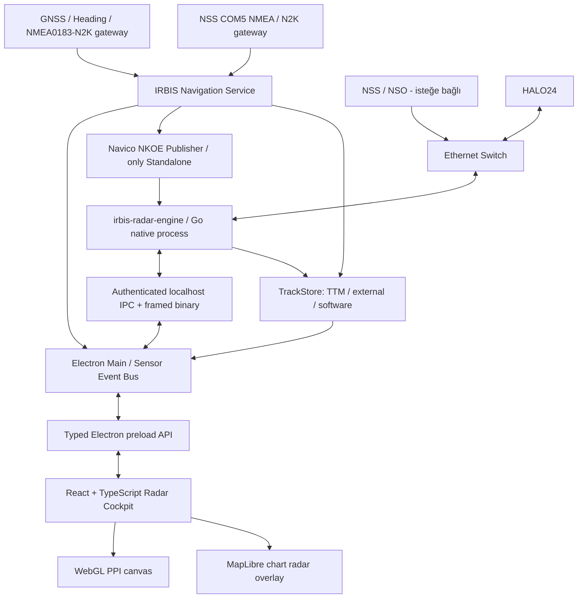
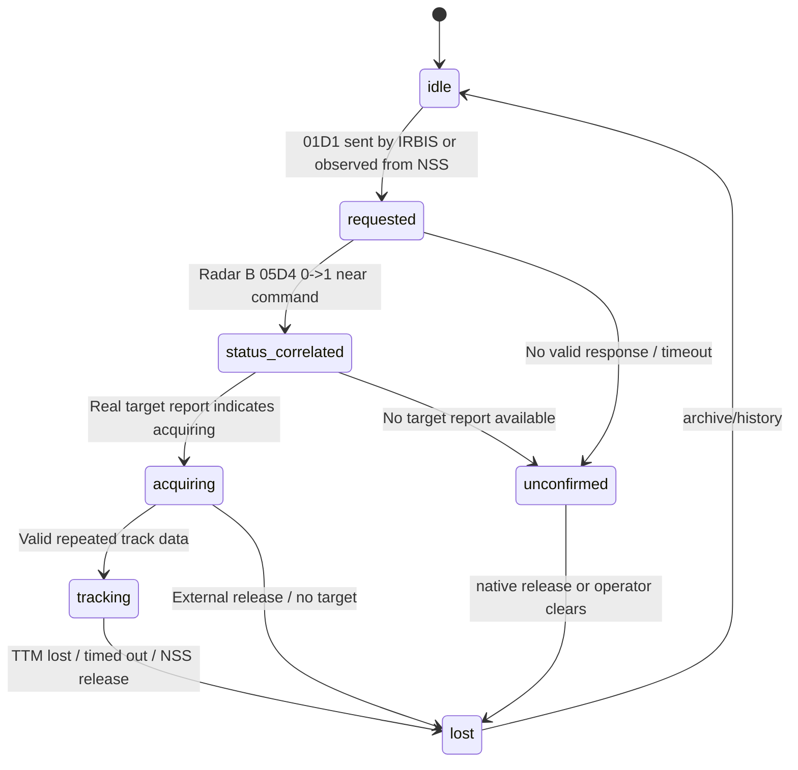

# IRBIS — SIMRAD HALO24 Radar Entegrasyonu

> **Cursor için uygulanabilir master teknik görev / mimari tasarım belgesi**  
> **Sürüm:** 1.0 | **Tarih:** 28.10.2026 | **Proje:** IRBIS / IRMARINETECH  
> **Kapsam:** HALO24 Ethernet radar görüntüsü, komutlar, NSS ile birlikte kullanım, NSS'siz mod, heading/GNSS, radar hedef edinme, NMEA TTM, hedef yönetimi, modern PPI/harita overlay, cihaz teşhis, kayıt/oynatma.  
> **Belge statüsü:** 27–28 Ekim 2026 cihaz testleriyle desteklenen mühendislik spesifikasyonu. Resmî Navico/Simrad SDK dokümanı değildir. Belirsiz protokol alanları açıkça `RESEARCH` olarak işaretlenmiştir.

---

## 0. CURSOR'A DOĞRUDAN TALİMAT — ÖNCE BURAYI OKU

Sen mevcut **IRBIS** Windows masaüstü projesine HALO24 radar entegrasyonu ekleyen kıdemli bir full-stack / realtime / marine systems mühendisisin. Kullanıcının mevcut uygulamasını yeniden oluşturma, mevcut ekranlarını ve çalışma mantığını bozma. **Önce repoyu incele**, gerçek dosya ve modül adlarını tespit et; bu dokümandaki klasörleri mevcut mimariye uyarlayarak uygulamaya geç. Sahte servisler, sonuç döndüren boş fonksiyonlar veya yalnızca mock arayüz teslim etme. Donanım gerektiren özelliklerde *simülasyon/replay* ile *canlı doğrulama* durumunu açıkça ayır.

**Projenin mevcut teknik yönü:** Windows 10/11 x64, **Electron + React + TypeScript + Vite**, **MapLibre GL JS**; mevcut/planlanan S-57 ENC / tile57 harita altyapısı; Node.js NMEA 0183 (UDP/TCP/seri), AIS, GNSS, SQLite, FLIR/IP kamera entegrasyonları. Harita motoru ileride Nautilus gibi alternatif bir ENC motoruna geçse bile radar bağımsız bir sensor/overlay katmanı olmalı. Önceki IRBIS tasarımındaki **Chart / Connect / Watch / Record** ayrımı ve **Device Center** fikrini koru. Kullanıcının mevcut UI renklerini ve navigasyon düzenini değiştirme; radar bölümünü onun tasarım diliyle bütünleştir.

**Çalışma yöntemin:**
1. Repo analizi ve dosya envanteri yap; mevcut Electron main/preload/renderer, sensor event bus, MapLibre katmanları, Device Center, SQLite modelleri, NMEA girişleri ve paketleme şeklini bul.
2. Gerekli modüller için kısa uygulama planı çıkar; sonra sırayla gerçekten uygula. Mevcut çalışan modülleri silme.
3. **Önce pasif alma ve offline replay**, sonra doğrulanmış kontrol komutları, sonra hedef edinme ve birlikte çalışma, son olarak NSS'siz navigasyon yayınlama.
4. Her adımda `typecheck`, test, build, offline replay ve mevcut uygulama regresyon kontrolü çalıştır.
5. Kendi başına gerçek donanıma yayın başlatma; Live/Transmit/Acquire/Navigation Publisher ancak yetkili operatörün açık seçimiyle etkinleşsin.
6. `PCAPNG okundu`, `UDP soketi gönderdi`, `radar cevap verdi`, `NSS hedef simgesi gösterdi`, `TTM alındı` gibi kanıt seviyelerini birbirinden kesin ayır.
7. Desteklenmeyen NMEA alanı, protokol alanı veya sürüm için değer **uydurma**; `unverified`/`unsupported` durumunu ver. Simrad'ın kendi protokollerini yeniden uyguluyoruz, üretici tarafından onaylanmış/certified ECDIS/MARPA olduğunu iddia etmiyoruz.

**Tamamlanmış sayılmak için:** Radar A/B verileri karışmadan gösterilmeli; NSS varken çalışmalı; NSS yokken ve gerçek harici heading/GNSS varsa bağımsız radar kontrolü/görüntüleme sağlanmalı; hedef edinme isteği cevabıyla ilişkilendirilmeli; `$RATTM` mevcutsa parse edilmeli; NSS yokken `$RATTM` gelmezse uydurma hedef hızı/CPA/TCPA üretilmemeli; tüm bunların canlı/örnek veri testleri ve belgeleri bulunmalı.

---

## 1. BİLDİĞİMİZ GERÇEKLER — KANIT DEFTERİ

### 1.1 Gerçek cihaz testinden doğrulananlar (28.10.2026 v6)

| Kapsam | Gerçek kanıt | Güven |
|---|---|---|
| PC -> Transmit | `00 C1 01`, ardından `01 C1 01`; Radar B `01 C4: 1 -> 5 -> 2` ve radar spoke akışı | **Doğrulandı** |
| PC -> Standby | `00 C1 01`, ardından `01 C1 00`; Radar B `01 C4 -> 1` | **Doğrulandı** |
| PC -> Menzil | `03 C1` + **metre × 10** (u32 little-endian, desimetre); radar `02 C4` üzerinden onay | **Doğrulandı** |
| Radar görüntüsü | `236.6.7.8:6678` UDP multicast, büyük datagramların IPv4 parçalanması, sürekli spoke akışı | **Ağ verisi doğrulandı**, tam görüntü çözücüsü ayrıca test edilmeli |
| NSS -> heading | `NKOE`, `12 F1`, `239.238.55.73:7527`, 72 bayt; gerçek v6'da **2.222 mesaj** | **Doğrulandı** |
| NSS -> nav | `NKOE`, `02 F8`, aynı grup/port; gerçek v6'da **2.222 mesaj** | **Gönderim doğrulandı**, tüm alanlar değil |
| NSS -> hedef edinme | `01 D1` uzunluğu 22, `236.6.7.20:6690` | **Yüksek güven** |
| PC -> hedef edinme | NSS'nin 22 baytlık `01 D1` içeriği PC'den tekrar gönderildi | **Doğrulandı** |
| Radarın hedef durumu | Radar B `05 D4`, sıfır tabanlı bayt `8`: NSS ve PC isteklerinden sonra `0 -> 1` | **Korelasyon doğrulandı; alanın resmî semantiği bilinmiyor** |
| NSS otomatik release | NSS `02 D1 01 00 00 00` (NSS hedefi) ve `02 D1 02 00 00 00` (PC sonrası); B `05 D4` `1 -> 0` | **Korelasyon doğrulandı; ID eşleme kuralları araştırılmalı** |
| NSS ekranı | Kullanıcı PC hedefinin NSS üzerinde de göründüğünü; iki hedefin ~10 sn sonra düştüğünü gözledi | **Bağımsız operatör gözlemi** |
| Seri hedef sonuçları | 27.10.2026 COM5 kayıtlarında `$RATTM` (manuel ve otomatik zone hedefleri) | **Seri kaydıyla doğrulandı** |
| Ethernet'te TTM | v6 PCAPNG'de `$RATTM` yok | **Bu PCAP özelinde yok**; seri/N2K'da yok demek değildir |

**Son v6 paketi / kesin örnek:**

```text
NSS 01D1  15:54:18.071267, frame 31251
PC  01D1  15:55:24.301432, frame 65235
Payload (birebir aynı):
01 D1 00 00 00 00 00 00 00 00 20 00 00 00 BE 03 00 00 00 00 00 00
```

- `payload[10..13]`: `32` (u32 LE), **mesafe adayı 32 metre**.
- `payload[14..15]`: `958` (u16 LE); **açı adayı 95,8°**; **True/Relative/ekran referansı henüz tam belirlenmedi**.
- Diğer sıfır alanların tamamının anlamı doğrulanmadı: **körlemesine değiştirme**.
- NSS komutundan **0,617 ms** sonra, PC komutundan **51,008 ms** sonra B `05D4[8]` `0→1`.
- NSS deneyinde durum ~**10,28 s**, PC deneyinde ~**10,05 s** aktif kaldı; ardından NSS kaynaklı `02 D1` ve `05D4[8]` `1→0`.
- Bu **hedef edinme isteğinin işletildiğini güçlü biçimde gösterir**, kararlı MARPA hesaplaması / hedef hız-vektörü üretildiğini tek başına kanıtlamaz.

### 1.2 DİKKAT: 27 Ekim ve 28 Ekim yakalamaları aynı cihaz IP'sinde olmayabilir

**28.10.2026 test tezgâhı:**
- PC `192.168.1.34`
- NSS `169.254.205.130`
- HALO24 `192.168.1.156`
- `Antaira LNX-500A` yönetilemeyen switch; unicast trafik eksik görülebilir.

**27.10.2026 ayrı referans kayıtları:**
- Radar `169.254.230.10`
- Simrad kontrolcü `169.254.212.184`
- NMEA/gateway `169.254.192.88`

**Asla kaynak IP'lerini sabit kodlama veya `169.254.* = NSS` gibi tahminde bulunma.** MAC, Navico discovery, HELLO/device ID, yayınlanan rol ve kullanıcı tarafından seçilmiş adapter bilgilerini birleştir; bilinemeyeni `Unknown Simrad Node` olarak göster. Windows NIC üzerinde aynı fiziksel ağa bağlı `192.168.*` ve `169.254.*` cihazlarının bulunması otomatik olarak her unicast yönde erişilebilir olduklarını kanıtlamaz: multicast alma, multicast yazma ve IP routing ayrı test edilmelidir.

### 1.3 Eski deneylerden öğrenilen temel hatalar

1. Radar A ve Radar B'nin `01 C4` durumunu **aynı değişkende tutma**: A çoğu zaman Standby, B Transmit; ikisi bağımsız.
2. `03 C1` içindeki u32 **desimetre**, metre değil. `1000` raw = `100 m`; `10000` raw = `1000 m`.
3. `05 D4` bayt8=1'i **“track acquired/confirmed”** diye adlandırma; `tracking-related status / observed active candidate` de.
4. `02 D1` içindeki takip ID'sini `$RATTM` hedef numarasıyla eşitleme. Önce eşleme kanıtı gereklidir.
5. NSS'den heading geliyorken PC de sahte/ikinci heading yayınlamasın.
6. `01 D1` mesajını geçmiş PCAP'ten körlemesine replay etmek **hareketli hedef seçimini** garanti etmez; canlı tıklanan ekonun güncel koordinatına ihtiyaç var.
7. NSS'nin `02 D1` gönderdiği 10 saniyelik kayıp olaylarını “radar kendiliğinden kapattı” diye loglama; *release source=NSS* bilgisini koru.
8. `.pcapng` içinde `$RATTM` olmamasını hedef hareket verisi hiç yok diye yorumlama; COM5'teki `$RATTM` kanıtı ayrı kaynak.

---

## 2. İKİ ÇALIŞMA MODU VE ALTERNATİF KAYNAKLAR

### 2.1 MOD A — `NSS_SHARED` (NSS + HALO24 + IRBIS)

```text
  Gerçek GPS + heading cihazları
                │ NMEA 0183 / NMEA 2000
                ▼
              NSS / NSO ───── NKOE / kontrol / MARPA ───┐
                  │ Ethernet                             │
                  └─────────┐                            │
                            ▼                            ▼
                       Ethernet Switch ◄──────────── HALO24
                            │                     UDP multicast
                            ▼
                         IRBIS PC
              ┌─────────────┴────────────────────┐
              │ Pasif spoke / report / NSS NKOE  │
              │ NMEA TTM seri çıkış (varsa)      │
              │ Yetkiliyse ortak kontrol / 01D1  │
              └──────────────────────────────────┘
```

**Varsayılan politika: `OBSERVE_ONLY`**. IRBIS:
- Radarın ve NSS'nin varlığını tespit eder; NSS varsa `NSS_SHARED` önerir.
- Radar görüntüsünü ve durumunu pasif alır; own-ship heading/position için mevcut IRBIS sensor bus'ını kullanır.
- NSS'nin gönderdiği `12 F1`, `02 F8`, keepalive ve `01 D1` olaylarını **okur, yeniden yayınlamaz**.
- Operatör `IRBIS kumandasına izin ver` seçmedikçe Transmit/Standby/Range/Acquire göndermez.
- IRBIS komut gönderirse NSS arayüzü de aynı radar durumunu görebilir (v6 ile gösterildi). Birbirinden habersiz iki kontrolcü arasında yarış olabilir; `command ownership`, `last-writer`, command cooldown, ACK/report doğrulaması ve UI kaynak etiketi uygula.
- **NSS varken IRBIS'in `$RATTM` alması için**, NSS'nin COM/RS232 NMEA0183 çıkışı veya uygun bir NMEA 2000–0183 gateway / mevcut çıkış bağlantısı ayrıca IRBIS'e bağlanabilir. TTM'nin Ethernet multicast üzerinde yayınlandığını varsayma.
- NSS/IRBIS hedef ID'si, radarın B/A kanalı ve `TTM` ID eşlemeleri **kaynak/namespace** bazında ayrı tutulur.
- NSS kaybolursa otomatik olarak kontrolü ele alma! Operatör onayıyla Standalone geçişi denenebilir.

### 2.2 MOD B — `STANDALONE` (NSS yok + HALO24 + IRBIS)

```text
      Gerçek GNSS sensörü      Gerçek heading / gyro sensörü
               │                    │
         NMEA 0183 / N2K       NMEA 0183 / N2K
               └────────┬───────────┘
                        ▼
                 IRBIS NAV SERVICE
        kaynak seçimi + checksum + validity + freshness
                        │
               ┌────────┴───────────────┐
               ▼                        ▼
      IRBIS own-ship/harita      HALO NKOE adaptörü
      pozisyon/heading          `12 F1` / `02 F8` /
      COG/SOG gösterimi         `01 D3` (ön test)
               │                        │
               └───────────┬────────────┘
                           ▼
                  Ethernet Switch ─── HALO24
                           │       spoke/status
                           ▼
                       IRBIS PPI
                  Radar kontrol / targets
                           │
              ┌────────────┴────────────────┐
              ▼                             ▼
        Radar status `05D4`           IRBIS Track Engine
        edinme durumu adayı           (gerekirse PC-side)
              │                             │
              └───── normalize tracks ──────┘
                            │
                 IRBIS UI / opsiyonel TTM output
```

**Stand-alone için şartlar / net sınırlar:**
- IRBIS **gerçek** heading (`HDT`, `THS`, uygun N2K heading PGN) ve GNSS position (`RMC`, `GGA`, `GNS`, uygun N2K PGN) almalı. COG, heading yerine kullanılmaz; sadece hareket doğrultusudur.
- Harici NMEA 2000 için gerçek **sertifikalı/uyumlu N2K gateway ve cihaz erişimi** gerekir; Ethernet UDP'ye NMEA 2000 PGN bytes dökmek yerine geçmez.
- NSS'nin v6'da 72 baytla gönderdiği NKOE `12 F1` / `02 F8` ve OpenCPN radar_pi'deki HALO speed `01 D3` üretim formatlarından ayrı bir **NavicoNkoePublisher** uygulanabilir. Bunun radarda her firmware'de yeterli ve kabul edilmiş navigasyon kaynağı olduğunu **cihaz üzerinde ayrıca ölç**.
- NKOE payload'daki bazı 56–64 alanları açık kaynak yorumunda bile **unknown/position?** olarak işaretli. Bunlara GPS lat/lon yazma! IRBIS'in own-ship GPS pozisyonu harita/geo-overlay için normal NMEA yolundan sağlanır; radara özgü tam GPS pozisyonu protokolü **araştırma konusu**.
- NSS yoksa seri porttaki `$RATTM` akışı **kaybolabilir**. Çünkü önceki COM5 çıktısının NSS/diğer gateway kaynaklı olabileceği henüz topolojik olarak kesin değil. Bu nedenle “radar hedefi track ediyor” diye TTM uydurma.
- Standalone mode iki seviyede gösterilir: **`STANDALONE_BASIC`** (kontrol, radar görüntüsü, heading ile PPI) ve **`STANDALONE_TRACKING_VERIFIED`** (hedefin kinematik track sonuçları gerçekten doğrulanmış). İkinci seviyeye otomatik terfi etme.
- Kendi radar plot/track motorumuzu geliştirebiliriz; bu ayrı bir çözüm sınıfıdır ve üretici MARPA çıktısıyla eşdeğer olduğu **söylenemez**.

### 2.3 MOD C — `REPLAY` (donanım olmadan geliştirilebilir)

- Offline `.pcapng`, `radar_events.log`, `test_sonuclari.json`, COM5 NMEA `.txt` girişleri.
- Gerçek kayıttaki TTM ve status/spoke verilerini zamana göre oynatır; **ağa hiçbir komut göndermez**.
- 0.5× / 1× / 2× hız, pause, zaman atlama, radar A/B filtreleme, target event markers, timeline.
- V6 fixture'larında NSS `01D1`, PC `01D1`, iki `05D4` durum geçişi ve NSS `02D1` olaylarını doğru göstermelidir.

### 2.4 MOD D — `PASSIVE_DIAGNOSTICS`

- Kullanıcının ilk bağlanacağı güvenli mod: hiçbir transmit, NKOE veya watch packet göndermez.
- MAC/IP/port/packets/s, aktif multicast grup, NMEA source quality, current radar states, capture drop, stale flags, raw HEX inspector.

### 2.5 Otomatik mod seçimi — kritik kural

| Gözlenen durum | IRBIS önerisi | Kontrol izni |
|---|---|---|
| Radar + NSS yayınları mevcut | `NSS_SHARED` | Pasif; manuel yetkilendirme ile komut |
| Radar var, NSS yok, geçerli harici HDT+GNSS var | `STANDALONE_BASIC` | Operatör onayı + test edilmiş adaptör |
| Radar var, NSS yok, heading yok | `PASSIVE_DIAGNOSTICS` | Radar görüntüsü mümkünse göster; target/MARPA işlemlerini kapat |
| NSS var, hem NSS hem PC heading gönderiyor | `NAV_SOURCE_CONFLICT` | PC NAV publish engellenir; operatör düzeltir |
| Radar yok, kayıt dosyası seçili | `REPLAY` | Ağ çıkışı yok |
| Kaynak belirsiz, MAC/role çelişkili | `DEGRADED` | Yeni kontrol komutu gönderme |

`NSS_CONNECTED` algılaması için tek IP'ye bakma. Aynı ağda NSS'nin `01 D3 / NKOE`, keep-alive, discovery heartbeat ve cihaz kimlikleriyle güven puanı oluştur; tespit yokluğu *NSS kesin kapalı* anlamına gelmeyebilir.

---

## 3. MİMARİ — MEVCUT ELECTRON'U BOZMADAN

**Öneri:** V6'nın çalışan Go protokol bileşenlerini IRBIS'e bağlanan bir **native radar sidecar** olarak evrimleştir. Node.js/Electron main process sensör bus ve komut yetkisini yönetir; React asla doğrudan Ethernet/serial socket açmaz. Go sidecar ağır UDP/spoke, parsing ve reassembly yükünü üstlenir. Kullanıcıdaki mevcut farklı bir native radar engine varsa aynı `IRadarAdapter` arayüzü üzerinden kullan; iki engine zorla çalıştırma.



**Önerilen klasör yapısı** (Cursor mevcut repo yapısına uyarlasın):

```text
src/
  main/
    devices/radar/
      RadarManager.ts
      RadarModeController.ts
      RadarCommandService.ts
      RadarPermissionService.ts
      RadarSourceResolver.ts
      RadarEventBridge.ts
      RadarRecordingService.ts
      RadarDiagnosticsService.ts
    navigation/
      NavigationSourceManager.ts
      Nmea0183Service.ts
      NmeaTtmParser.ts
      NavigationHealth.ts
      NavicoNkoePublisherController.ts
  preload/
    radar-api.ts
  renderer/
    features/radar/
      pages/RadarPage.tsx
      components/RadarPPI.tsx
      components/RadarControlPanel.tsx
      components/RadarStatusBar.tsx
      components/RadarTrackTable.tsx
      components/RadarTrackDetail.tsx
      components/RadarSourceHealth.tsx
      components/RadarDiagnosticsDrawer.tsx
      components/RadarOverlaySettings.tsx
      hooks/useRadarSession.ts
      hooks/useRadarTracks.ts
      state/radar-store.ts
      render/ppi-webgl.ts
      render/spoke-texture.ts
      render/map-radar-layer.ts
      types/radar.ts
native/
  irbis-radar-engine/          # mevcut v6 Go kaynaklarından refactor
    cmd/irbis-radar-engine/main.go
    internal/navico/
      discovery.go
      sockets.go
      capture.go
      control.go
      nkoe.go
      spoke.go
      reports.go
      targets.go
      decoder_tests.go
    internal/ipc/
      server.go
      messages.go
    internal/replay/
      pcapng.go
      fixtures.go
    internal/telemetry/
      metrics.go
assets/radar-fixtures/           # küçük, lisans/mahremiyet kontrollü fixture'lar
```

**IPC önerisi:** Windows'ta native process'i Electron `child_process.spawn` ile başlat; özel bir session token ile rastgele `127.0.0.1` portunda authenticated WebSocket/HTTP veya Windows named pipe üzerinden konuş. **Kritik kontrol endpoint'lerini dış ağa açma.** Status/track olayları JSON; yoğun spoke/render görüntüsü **binary framed** veri olarak geçsin (binlerce JSON/React render'ı yapma). Windows Firewall, port çakışması, subprocess crash/restart ve app quit durumlarını yönet.

**DİKKAT lisans:** OpenCPN `radar_pi` GPLv2. Referans ve protokol araştırması olarak inceleyebilirsin; lisans uyumluluğu değerlendirmesi yapılmadan kodunu kapalı kaynak ticari IRBIS'e kopyalama/linkleme. V6'daki bizim özgün test kodunu, kendi fikrî haklarımız açısından ayrı kontrol ederek adapte et.

---

## 4. HALO24 AĞ PROTOKOLÜ: BİLDİĞİMİZ ADRESLER

| UDP multicast | Görev | Yön | Kanıt ve not |
|---|---|---|---|
| `236.6.7.8:6678` | Radar raw spoke/PPI görüntüsü | Radar → istemci | Görüntü paketi; IP fragmentation olabilir |
| `236.6.7.9:6679` | Radar B status `01C4`, `02C4` ve diğer raporlar | Radar → istemci | **28.10 v6 B** |
| `236.6.7.13:6003` | Radar A status | Radar → istemci | **28.10 v6 A**, B ile karıştırma |
| `236.6.7.10:6680` | Radar kontrol: TX, standby, range, keepalive | PC/NSS → multicast | Gerçek çalıştı |
| `236.6.7.14:6002` | Paralel kontrol kanalı | NSS → multicast | Kaydedildi, aktif gönderim için araştır |
| `236.6.7.20:6690` | B tarafı Watch Target `01D1`, `02D1`, ayrıca `01D3` | PC/NSS → multicast | Gerçek çalıştı |
| `236.6.7.15:6005` | Paralel hedef / hız mesajları | NSS → multicast | Firmware/kanal bağımlı |
| `236.6.7.19:6689` | Radar B `05D4`, `03D4`, `01D4` vb. | Radar → istemci | Hedef durumunu burada izle |
| `236.6.7.13:6006` | Radar A `05D4` vs | Radar → istemci | B ile ayrı state |
| `236.6.7.5:6878` | Navico discovery (`01B1`, `01B2`) | İki yön | Kimlik çözümlemesi için araştır |
| `239.238.55.73:7527` | `NKOE` gerçek heading (`12F1`) / nav (`02F8`) | NSS, bazı modlarda IRBIS → multicast | 72 bayt veri |

**Önemli:** Ağdaki IP ve bazı multicast kanal rolleri HALO firmware/kanal/mod ile değişebilir. Dinamik keşif yapılandırılabilir olmalı; protokol haritası `navico-halo24` adaptörüne ait olmalı, genel radar sistemine gömülmemeli.

### 4.1 Control codec (çok önemli — byte-level)

```ts
// Örnek algoritma; gerçek projede yetkili backend adapter kullan.
function makeTxFrames(enabled: boolean): Uint8Array[] {
  return [
    Uint8Array.from([0x00, 0xC1, 0x01]),
    Uint8Array.from([0x01, 0xC1, enabled ? 0x01 : 0x00]),
  ]; // İKİ ayrı UDP datagramı; birleştirme.
}

function makeRangeFrame(rangeMeters: number): Uint8Array {
  if (!Number.isSafeInteger(rangeMeters) || rangeMeters < 50 || rangeMeters > 72704) {
    throw new Error('Radar menzili geçersiz');
  }
  const packet = new Uint8Array(6);
  packet.set([0x03, 0xC1]);
  new DataView(packet.buffer).setUint32(2, rangeMeters * 10, true); // DESİMETRE, LE
  return packet;
}

function makeAcquireCandidate(rangeMeters: number, bearingTenths: number): Uint8Array {
  // LAB-VALIDATED shape; angle reference is NOT yet completely characterized.
  if (!Number.isInteger(rangeMeters) || rangeMeters < 1 || rangeMeters > 72704) throw Error('range');
  if (!Number.isInteger(bearingTenths) || bearingTenths < 0 || bearingTenths >= 3600) throw Error('bearing');
  const packet = new Uint8Array(22);
  packet[0] = 0x01; packet[1] = 0xD1;
  const view = new DataView(packet.buffer);
  view.setUint32(10, rangeMeters, true); // metre adayı
  view.setUint16(14, bearingTenths, true); // 0.1° adayı; reference frame RESEARCH
  return packet;
}

function makeReleaseCandidate(nativeTargetId: number): Uint8Array {
  // `02 D1` ID şeması candidate, ID kaynağını doğrulamadan active UI'ye bağlama.
  if (!Number.isInteger(nativeTargetId) || nativeTargetId < 1 || nativeTargetId > 65535) throw Error('target ID');
  const b = new Uint8Array(6);
  b.set([0x02, 0xD1]);
  new DataView(b.buffer).setUint16(2, nativeTargetId, true);
  return b;
}
```

TX komutları sırasında iki datagram arasında v6'nın yaptığı gibi **25 ms** aralık kullanılabilir; hız sınırı, komut sırası, sabit NIC ve operator gating olmalı. `UDP send success` eşittir **sadece socket sonucu**; `RadarApplied` için belirlenen A/B radar durum cevabını bekle.

### 4.2 Radar state / onay / zaman aşımı

- `01 C4` payload durum alanı (v6 tespit): `1=Standby`, `5=transition`, `2=Transmit`.
- `02 C4` içinde offset `2..5`: raw `u32 LE / 10 = metre`.
- `05 D4` offset `8`: sadece `tracking-related state byte`; `0→nonzero`, `nonzero→0` geçişlerini logla ve gönderene yakınlıkla korele et.
- **A/B state ayrı:** `radarId + channel + dstAddress + dstPort + messageType`.
- ACK yoksa komutu tekrarlayıp spam yapma: `UNKNOWN_RESULT` göster, operator yeniden denesin.
- `02 D1` release otomatik NCC/NSS kaynaklıysa ve operatör IRBIS'ten iptal etmediyse `origin=NSS` yaz.
- Tüm komutlarda `requestId`, `sentAt`, `txHex`, `sourceNic`, `sourceIP`, `dest`, `matchingRadarFrame`, `observedAt`, `outcome`, `confidence` sakla.

### 4.3 Keep-alive ve sahiplik

V6'dan:

```text
A0 C1
03 C2
04 C2
05 C2
0A C2
```

Bu mesajların döngü düzeni için OpenCPN `NavicoControl::RadarStayAlive()` incelenmeli. **NSS bağlıysa onun keep-alive hizmetini ikinci kez başlatma.** NSS yok ve operatör Standalone etkinleştirdiyse uyumlu keep-alive scheduler çalıştır; kontrollü cihaz testinde zaman aralıklarını doğrula. IRBIS normal kapandığında hâlihazırda sahibi olduğu radarı güvenli Standby'a al; ancak NSS ile paylaşılan ortamda diğer kontrolcünün işini kesebileceği için **otomatik Standby politikasını mod/ownership bazında yap**.

---

## 5. NAVİGASYON — HEADING, COG, SOG, GPS'İ DOĞRU AYIR

### 5.1 Sensör veri modeli

```ts
export type NavigationSample = {
  sourceId: string;
  timestamp: number;  // unix ms
  headingTrueDeg?: number;          // sensör/pruva; sadece geçerli kaynak
  headingMagneticDeg?: number;
  magneticVariationDeg?: number;
  latitude?: number;
  longitude?: number;
  fixValid: boolean;
  cogTrueDeg?: number;              // rota / yer üzerindeki hareket doğrultusu
  sogKnots?: number;
  rotDegPerMin?: number;
  headingValid: boolean;
  positionValid: boolean;
  ageMs: number;
  quality: 'valid' | 'stale' | 'invalid' | 'unknown';
  rawSentence?: string;
};
```

Kaynaklar: mevcut IRBIS NMEA0183 UDP/TCP/serial (HDT/THS/HDG/RMC/GGA/GNS/VTG); N2K gateway varsa PGN 127250 heading, 129025/129029 position, 129026 COG/SOG (model/ölçek vendor doğrulamasıyla). AIS ownship `VDO` uygun olsa bile heading kaynağı olarak körlemesine kullanma. Sensörün latency, quality/fix, tarih/saat, checksum ve güncellik süresini izle.

**Doğrulama:** Heading 3 s, GPS fix 3 s gibi başlangıç TTL'leri konfigüre edilebilir; kaynağın yayın hızına göre ayarla. Stale olunca harita overlay north-up georeference ve MARPA uygunluğunu düşür. COG ve HDT'yi `0°` olduğu için geçersiz sayma; `NaN/undefined/validity flag` kullan.

### 5.2 Navico NKOE (72 bayt) payload

28 Ekim NSS kaydında ve OpenCPN `NavicoReceive.cpp` yapısında:

```text
bytes [0..3]   ASCII "NKOE"
bytes [4..7]   00 01 90 02
bytes [8..9]   big-endian sequence counter
bytes [10..35] vendor / mostly unknown
bytes [36..37] 12 F1 (heading) veya 02 F8 (navigation)
bytes [38..39] 01 00
bytes [40..47] timestamp ms alanı (LE)
bytes [48..55] vendor alanı
bytes [56..64] vendor/unknown (GPS lat/lon olduğu doğrulanmadı)
heading: bytes [65..66] unsigned LE, angle = raw * 360 / 63488
navigation: [66..67] COG unsigned LE; [68..69] SOG vendor scale (ref code + tests)
```

**Kural:** `0xFFFF` gibi geçersiz göstergeleri gerçek `360°` veya sıfır diye yorumlama. Zamanı Windows sistem saatinden üretirken UTC epoch ve doğrulanmış endianness kullan. 27/28 Ekim kayıtlarında raw `u05a/u05b` alanlarının bilinen GPS pozisyonlarıyla eşleştirilmesi **henüz yapılmadı**. `makeNKOE` v4 prototipindeki sahte/zero unknown alanların cihaz tarafından kabul edildiğini iddia etme; kontrollü A/B test gerekir.

### 5.3 Standalone yayınlayıcı karar ağacı

```text
NSS/MFD NKOE aktör görüldü mü?
  EVET -> IRBIS NavicoNkoePublisher STOP + conflict warning
  HAYIR -> gerçek heading sensor var mı + quality fresh mi?
    HAYIR -> NKOE publish STOP; MARPA unavailable; basic PPI only
    EVET -> standalone operatör izni var mı?
      HAYIR -> pasif
      EVET -> NKOE `12 F1` yayın test modu
          + COG/SOG varsa `02 F8` / uygun `01 D3`
          + radarın hedef/heading kullanımını laboratuvarla doğrula
```

`01 D3` ikincil mesaj ailesi `236.6.7.20:6690` ve `236.6.7.15:6005` üzerinden görülmüştür; NKOE ile aynı şey değildir. OpenCPN kaynaklarında HALO speed yapısı incelenebilir. GPS pozisyonunun kendisi bu kanallar üzerinden hangi vendor field ile radara gittiği **çözülmüş değil**. Bu nedenle modül *NSS equivalent fully certified* olarak gösterilmemeli.

---

## 6. RADAR GÖRÜNTÜSÜ: RAW SPOKE -> MODERN PPI

### 6.1 İki ayrı veri yolu

**Canlı:** native UDP multicast socket (`236.6.7.8:6678`), işletim sistemi IP fragment reassembly; radar frame/spoke decoder → renderer için normalleştirilmiş radial lines.

**Kayıt/replay:** PCAPNG `Enhanced Packet Block` okuma → Ethernet/VLAN, IPv4/UDP, UDP header ve IPv4 fragment reassembly → aynı decoder → aynı renderer. **Canlı UDP için uygulamada IP parçalarını elle birleştirmek normalde gerekmez**, ama offline PCAP parser için gerekir. IP 4-tuple/protocol/IP identification/fragment offset/MF/timestamp ile eksikleri takip et; out-of-order ve timeout; bellek sınırı koy.

V4/v6'da büyük radar datagramları ~12 IPv4 fragment olarak gözlendi; bu değer sabit paket formatı değildir. `09 C4` 399 bayt status payload **radar spoke sanılmamalı**. Gerçek spoke payload başlığı/scanline boyu için önceki PCAP fixtures + OpenCPN `NavicoReceive::ProcessFrame` kullanılarak **ayrı decoder fixture testleri** yapılmalı. Kanıtsız sabit 4096/2048 spoke kabul etme; farklı firmware/mode olasılığını test et.

### 6.2 Normalize frame / renderer API

```ts
export type RadarSpoke = {
  radarId: string;
  channel: 'A' | 'B';
  receivedAtMs: number;
  sweepId?: number;
  azimuthRaw: number;      // dönüştürülmeden ham değer
  azimuthDeg?: number;     // codec test edilirse
  relativeBearingDeg?: number;
  rangeMeters: number;
  sampleCount: number;
  intensity: Uint8Array;   // decoder normalize ettiği 0–255 örnekler
  dopplerClass?: Uint8Array;
  codecVersion: string;
  isValid: boolean;
};
```

- Renderer WebGL/Canvas: azimuth → radial sample → polar texture (RGBA) / polar-to-Cartesian shader.
- Persist ve replay: raw/spoke payload + version tag; UI'da her frame için JSON serileştirmesi yapma.
- PPI için dark navy/black arka plan, radar eko renkleri için Green/Amber/Multicolor paletleri; alfa, gain görüntüleme kontrastı; trail fade; inter-sweep smoothing **opt-in**.
- Operatörün seçtiği radarın gerçek gain/sea/rain kontrollü algoritmasını codec kesinleşmeden simüle komutla değiştirme; yalnız ekran efektlerini ayrı isimlendir.
- Metrikler: spokes/s, UDP B/s, corrupted datagrams, fragment loss, decode latency, render FPS, dropped UI frames, average queue depth.

### 6.3 Haritaya radar overlay / coğrafi referans

**Own-ship GPS koordinatı ve TRUE heading geçerli olduğunda** radar ekoları georeference edilir. Radar dönebilir dünya north-up haritaya overlay olur; MapLibre image/custom WebGL layer ile grid paylaşılır. Daha başta MapLibre chart/ENC layer API'sini tahrip etme.

True/relative dönüşümü (kalibre edilmeden üretim güvenliği için kullanılmaz):

```ts
// Örnek: eğer radar açı decoded olarak teknenin pruvasına RELATIVE ise:
const trueBearing = ((headingTrueDeg + relativeBearingDeg) % 360 + 360) % 360;
const rad = trueBearing * Math.PI / 180;
const eastMeters = rangeMeters * Math.sin(rad);
const northMeters = rangeMeters * Math.cos(rad);
// WGS84/ENU -> lat/lon projeksiyonu için mevcut geodesic/geo engine kullan.
```

**Ama** `01D1` açı baytlarının bu sistemle aynı referansı kullandığı **kanıtlanmadı**; watch target için ayrı `RadarBearingCalibration` geliştir. Fiziksel radar offset/heading alignment/antenna location, PPI azimuth zero, chart projection ve radar horizon/range calibration kullanıcı tarafından yönetilsin. Harita georeference hesaplarında MapLibre ekran piksel açısını doğrudan radar bearing diye kullanma.

**Heading yoksa:** `RELATIVE` PPI üzerinde eko gösterebilirsin, **kesin north-up/world-overlay gösterme**; `HDG REQUIRED` uyarısı göster. Position yoksa kendi gemi merkezli relative PPI göster; GPS varmış gibi haritaya radar raster yerleştirme.

---

## 7. RADAR HEDEF İZLEME — İSTEK / CEVAP / GERÇEK TRACK

### 7.1 İki farklı işlem: karıştırma

**A — Radar'a hedef edinme talebi gönderimi:** `01 D1` 22 bayt UDP, status `05 D4` correlation ve NSS ekranında sembol. V6 ile doğrulandı. Bu bir **kontrol komutu**.

**B — Takip edilen hedefin hareket verisini almak:** `$RATTM` / `$RATLL` veya radar native target-report (henüz tamamen çözümlenmedi). Bu bir **sensör çıktısı**. `01D1` paketinden tek başına hedefin hızı, rotası, CPA veya TCPA hesaplanmaz.

IRBIS'teki mimari: `AcquisitionCommand` ≠ `RadarTrack`.

### 7.2 Hedef edinme UI akışı

1. Operatör radar PPI'da **gerçek eko** üzerine tıklar veya yakın hedef seçer.
2. PPI tıklama koordinatı `pixel → PPI polar range/azimuth` dönüştürülür. Radar A/B doğru kanal seçilir.
3. Eko varlık kontrolü: örnek yoğunluk ve komşuluk doğrulama; boş 11 m / 79° otomatik değer yok.
4. **Açı referansı çözülmediyse** kontrolü `LAB / EXPERIMENTAL` etiketli tut. Canlı normal kullanım için kalibrasyon fixture'ı / saha testi gerektir.
5. `01 D1` gönderilir; backend `requested` track state oluşturur, eşleşen `05D4[8]` değişimi varsa `radarStatusCorrelated=true` yapar.
6. Gerçek TTM gelirse uygun ID/eşleme koşulları sağlanarak `acquiring` / `tracking` / `lost` state'a terfi ettirilir. TTM yoksa `trackingConfirmed=false`; **bilinmeyen hedef hareket verisini sıfır olarak üretme**.
7. `02 D1` NSS kaynaklıysa yerel ilişkiyi logla; operatöre `NSS released target` yaz. IRBIS kendi release komutunu ancak güvenilir native ID var ve kontrol yetkisi verilmişse gönderebilir.
8. Hedef kaybolunca ekranda 8–15 sn sabit bir timeout varsayarak otomatik silme; kaynak timeout/TTM status/observed release ile state machine yönet. Tek kullanımlık v6 10 sn gözlemi tüm radarlar için kural değildir.

### 7.3 Track state machine



`status_correlated` ≠ `tracking`; bu açık ifade kod yorumlarında, API'de, UI'da ve testlerde korunsun.

### 7.4 Hedef veri modeli

```ts
export type RadarTrack = {
  uid: string; // IRBIS global namespace id, NEVER just device targetId
  radarId: string;
  channel: 'A' | 'B';
  source: 'NSS_NMEA_TTM' | 'EXTERNAL_TTM' | 'NAVICO_STATUS' | 'IRBIS_SOFTWARE_TRACKER';
  nativeId?: number | string; // device id or TTM id, not interchangeable
  requestId?: string;
  rangeMeters?: number;
  relativeBearingDeg?: number;
  trueBearingDeg?: number;
  latitude?: number;
  longitude?: number;
  speedKnots?: number;
  courseTrueDeg?: number;
  cpaMeters?: number;
  tcpaSeconds?: number;
  acquisitionType?: 'manual' | 'automatic' | 'unknown';
  state: 'requested' | 'status_correlated' | 'acquiring' | 'tracking' | 'lost' | 'unconfirmed';
  sourceTimeMs: number;
  lastSeenAtMs: number;
  quality: 'confirmed' | 'candidate' | 'stale' | 'invalid';
  fieldsKnown: string[];
  rawEvidence?: { frame?: number; hex?: string; sentence?: string };
};
```

Gerçek TTM'den hedefin distance/bearing/speed/course/CPA/TCPA bilgilerini doldur; `$RATTM` içindeki hedef numarası ile `02D1` native ID'nin birebir aynı olduğunu varsayma. Aynı hedefin NSS, native radar ve IRBIS software tracker kayıtları için veri füzyonu ancak ölçüm yakınlığı, timestamp ve source confidence ile ayrı eşleştirme modülünde yapılsın.

### 7.5 `$RATTM` NMEA 0183 hedef çözümleyici

**Önceki 27 Ekim COM5 kaydı gerçekten şu formatı içeriyor:**

```nmea
$RATTM,03,4.88,289.6,T,0.0,0.0,T,4.87,-0.0,N,3 (Halo24-640 A),T,,132017,M*47
```

- `RA` talker radar; `TTM` Tracked Target Message. Örnek kayıtta menzil NM, açı `T` true bearing, hedef speed/course ve CPA/TCPA alanları var. `T`/`Q`/`L` ve `M`/`A` statülerini NMEA TTM spesifikasyonuna uygun parser üzerinden çöz; örnekte son `M` manual acquisition işaretidir.
- `NMEA 0183` checksum `*XX` XOR doğrulaması, CRLF termination, uzunluk, alan sayısı, geçersiz sayılar ve `NaN` denetimi zorunlu.
- TTM hedef sayısı bir kaynak içinde tekrar kullanılıyor olabilir; `sourceId:talker:targetNumber` + zaman üzerinden geçmişe bağla. `TLL` gelirse lat/lon kullan, yoksa sadece own-ship GPS + true bearing ile **geçerli referansta** konuma dönüştür.
- Seriden `COM5` cihaz adı asla sabit olmasın; Windows COM port kullanıcı seçimi ve auto-discovery, baud/parity/stopbits ayarları ile destekle. `COM5` sadece önceki test tezgâhındaki örnektir.
- TTM akışı NSS tarafından üretiliyorsa NSS kaldırıldığında yok olabilir: standalone `source = unavailable` mesajı ver.

### 7.6 ZoneTrack — sonraki faz; bugün varlığını belgeleyelim

27 Ekim ayrı testinde `14 D1` 19 bayt ile 2 bölgeye ait `range start/end` ve `angle start/end` alanları güçlü biçimde eşleşti; `01 D4` raporunda aynı veri görüldü. Ancak Live ZoneTrack üretim UI'si **bugünkü temel MVP'nin dışında**, açık `experimental` feature-flag altında olmalı. Benzer şekilde `17 D1` bir zone status query hipotezi; kapatma komutu diye çağırma. Eski paket raporunu fixture/ek doküman olarak sakla.

### 7.7 Eğer NSS'siz TTM yoksa: `IRBIS_SOFTWARE_TRACKER` ayrı faz

Aşağıdaki ileri faz, radara `01D1` gönderiminden bağımsızdır:

- Radar raw spoke -> kalibre edilmiş polar intensity grid.
- Sea clutter/rain suppression ve adaptive threshold (CFAR) *yalnız yazılımsal*.
- Connected components/blob, centroid, range/bearing ölçümü, mask/echo confidence.
- Scan-to-scan association (gating, nearest-neighbor / Hungarian), Kalman CV/CT state estimation.
- Ownship GNSS/heading ile stabilized relative/true motion, hedef velocity/course ve CPA/TCPA yalnız yeterli güvenilir ölçüm geçmişi olduğunda.
- Artifakt, land clutter, multipath, shadow sector ve short range reject kuralları.
- Bu çıktı **Navico MARPA ile eşdeğer değildir**; UI'da `IRBIS Tracking (experimental)` diye ayrı kaynağı göster. Algoritma doğrulama datasetleri ve gerçek deniz testi olmadan çarpışma önleme uyarısı üretme.

### 7.8 Track verisi diğer sistemlere nasıl **gönderilecek**?

**Üç ayrı yönü kesin ayır:**

| Veri | Kimin için? | Format |
|---|---|---|
| Hedef edinme / bırakma | **IRBIS → HALO24** | Native UDP `01 D1` / `02 D1` |
| Radarın hedef sonucunu okumak | **NSS NMEA OUT / gateway → IRBIS** | `$RATTM` ve uygun `$RATLL` / N2K gateway |
| IRBIS'in güvenilir hedefini diğer uygulamalara iletmek | **IRBIS → downstream consumer** | NMEA 0183 `TTM`/`TLL`, JSON/WS; test/izinli export |

**TTM mesajlarını HALO24'e “takibi başlat” diye gönderme.** Bu yanlış yön. IRBIS TTM export'u yalnızca doğrulanmış track kaynağına dayanmalı; NMEA talker/origin açık olmalı; kopyalanan NSS TTM'yi tekrar NSS'ye besleyip loop oluşturma. AIS `VDM` benzeri cümleler radar hedefi değildir, AIS MMSI uydurma.

---

## 8. UYGULAMA İÇİ TİPLİ SERVİS SÖZLEŞMESİ

```ts
export type RadarMode = 'PASSIVE_DIAGNOSTICS' | 'NSS_SHARED' | 'STANDALONE_BASIC'
  | 'STANDALONE_TRACKING_VERIFIED' | 'REPLAY' | 'DEGRADED';

export type CommandOutcome = 'SOCKET_SENT' | 'RADAR_APPLIED' | 'STATUS_CORRELATED'
  | 'UNKNOWN_RESULT' | 'REJECTED' | 'TIMEOUT' | 'BLOCKED';

export type RadarDevice = {
  radarId: string;
  manufacturer: 'Navico';
  model: string; // live device discovery
  firmware?: string;
  sourceIp: string;
  macAddress?: string;
  adapterId: string;
  discoveredAt: number;
  lastSeenAt: number;
  channels: Array<{ id: 'A' | 'B'; statusGroup: string; reportGroup: string;
    state: 'standby' | 'transition' | 'transmit' | 'unknown'; rangeM?: number }>;
};

export type RadarCommand =
  | { kind: 'transmit'; enable: boolean; radarId: string; channel: 'A' | 'B' }
  | { kind: 'set-range'; meters: number; radarId: string; channel: 'A' | 'B' }
  | { kind: 'acquire'; radarId: string; channel: 'A' | 'B'; rangeM: number;
      bearingTenths: number; echoTimestamp: number }
  | { kind: 'release'; radarId: string; channel: 'A' | 'B'; nativeId: number };

export interface IRadarAdapter {
  connect(adapterId: string): Promise<void>;
  disconnect(): Promise<void>;
  discover(): Promise<RadarDevice[]>;
  subscribeEvents(onEvent: (event: RadarEvent) => void): () => void;
  sendCommand(cmd: RadarCommand, operatorAuth: string): Promise<{
    requestId: string; initial: CommandOutcome;
  }>;
  setMode(mode: RadarMode): Promise<void>;
  startRecording(): Promise<string>;
  stopRecording(): Promise<void>;
  openReplay(filePath: string): Promise<void>;
}
```

**Events:** `radar:device`, `radar:state`, `radar:spoke-binary`, `radar:track`, `radar:target-attempt`, `radar:target-status-transition`, `radar:nav-source`, `radar:command-ack`, `radar:alarm`, `radar:diagnostic`, `radar:replay-state`.

**Electron preload:** `contextIsolation=true`, `nodeIntegration=false`, allowlist IPC channels, type checks & operator authorization in main process. Renderer cannot submit raw arbitrary HEX/UDP packets by default. Diagnostic raw HEX **read-only**. Feature flags for experimental messages.

---

## 9. MODERN IRBIS RADAR ARAYÜZÜ (KULLANIŞLI, SİMİRAD'I KOPYALAMAYAN)

### 9.1 Ana panel düzeni

```text
┌─────────────────────────────────────────────────────────────────────────────────────┐
│ IRBIS   Charts | Radar | Devices | Record          GPS● HDG●   HALO● NSS●   15:55 │
├───────────────────┬───────────────────────────────────────────────┬─────────────────┤
│ RADAR DEVICES     │  Radar PPI  [Radar only | Chart Overlay]     │ RADAR CONTROL   │
│ ● HALO24          │                                               │ Status TRANSMIT │
│   Channel A STBY  │      bearing / range rings / echos           │ Range [100 m]   │
│   Channel B TX    │                                               │ Gain [Auto]     │
│ ● NSS Connected   │      click echo -> Acquire (guarded)         │ STBY / TX       │
│ NAV SOURCES       │                                               │                 │
│ HDT 278° VALID    │                                               │ TARGETS         │
│ POS  FIX VALID    │                                               │ 01 Acquiring    │
│ COG — invalid     │                                               │ 02 Lost         │
│ NKOE publisher OFF│                                               │                 │
├───────────────────┴───────────────────────────────────────────────┴─────────────────┤
│ RX 562 pkt/s | Spokes 220/s | 05D4[8]=0 | Drops=0 | NSS_SHARED READONLY | REC●       │
└─────────────────────────────────────────────────────────────────────────────────────┘
```

Görünüm mevcut IRBIS temasına göre **minimal/profesyonel**, yoğun ekranı modern bilgi hiyerarşisi ile ayır: harita + radar alanı büyük, kontroller kompakt. Simrad ekran görüntüsünü veya marka UI'sını kopyalama.

### 9.2 Çalışması gereken ekran/bileşenler

**Radar sayfası**: PPI Live/Replay, North-Up / Head-Up (heading yeteneğine göre), palette, range rings, VRM/EBL ve hedef listesi. `Acquire` yalnız canlı eko ve kalibrasyon koşulları sağlanmışsa.

**Harita ekranı**: `Radar Overlay` aç/kapa, opacity slider, radar range circle, track symbols, AIS ile ayrı katman, ownship/heading validity badges. MapLibre kayıp/yeniden başlatma bu sensör katmanını bozmasın.

**Device Center > Radar**: NIC seçici (Realtek/Wi-Fi/sanal arayüzleri ayrıştır), IP/MAC/discovery, A/B, firmware varsa, multicast memberships, RX/TX counts, link age, Navico/NSS presence, heartbeat, TTM source, NKOE publisher conflict, diagnostic export.

**Target Details**: source (`NSS_NMEA_TTM`/`NAVICO_STATUS`/`IRBIS_SOFTWARE_TRACKER`), `Request`, `Radar status`, `Tracking` ayrı satır; native ID vs TTM ID; range, bearing, speed, course, CPA/TCPA yalnız mevcutsa. `Unknown` değerleri `0` diye yazma.

**Record / Timeline**: PCAPNG/NMEA/tracks/screenshots olay işaretleri, replay, filtre, JSON/CSV export ve teknik kanıt zinciri.

### 9.3 Ekranda gösterilecek temel durumlar

- `RADAR CONNECTED`, `TRANSMIT`, `STANDBY`, `NO SPOKES`, `STALE NAV`, `NSS PRESENT`, `CONFLICT`, `GPS INVALID`, `HEADING INVALID`.
- Target kartında: `Requested` → `Radar status correlated` → `Tracking confirmed (NMEA)` veya `Unconfirmed/Lost`; “track confirmed” statüsünü `05D4` bir bayttan çıkarmayız.
- Radar B ve A iki ayrı küçük durum kartı; B yayın yaparken A standby olması normal olabilir.
- `Transmit` eylemi onay diyaloğu, devredışı bırakma/E-stop; test modunda canlı yayın tehlikesini belirt.

---

## 10. KAYIT, HATA GÜNLÜĞÜ, SQLITE VE TEKRAR OYNATMA

Önerilen SQLite tabloları (mevcut migration sistemi varsa ona göre):

```sql
CREATE TABLE IF NOT EXISTS radar_devices (
  radar_id TEXT PRIMARY KEY, model TEXT, ip TEXT, mac TEXT,
  adapter_id TEXT, first_seen_ms INTEGER, last_seen_ms INTEGER
);
CREATE TABLE IF NOT EXISTS radar_command_events (
  request_id TEXT PRIMARY KEY, radar_id TEXT, channel TEXT,
  action TEXT, sender TEXT, sent_at_ms INTEGER,
  tx_hex TEXT, dest TEXT, outcome TEXT,
  radar_frame INTEGER, observed_at_ms INTEGER, evidence_json TEXT
);
CREATE TABLE IF NOT EXISTS radar_tracks (
  uid TEXT PRIMARY KEY, radar_id TEXT, channel TEXT,
  source TEXT, native_id TEXT, state TEXT,
  first_seen_ms INTEGER, last_seen_ms INTEGER, last_data_json TEXT
);
CREATE TABLE IF NOT EXISTS radar_recordings (
  recording_id TEXT PRIMARY KEY, path TEXT, started_ms INTEGER,
  stopped_ms INTEGER, adapter_id TEXT, evidence_json TEXT
);
```

Raw PCAPNG'yi DB'ye BLOB olarak koyma; dosyada sakla ve SQLite'da metadata/path. NMEA raw satırlarını ve program diagnostik JSONL event loglarını aynı `recordingId` ve monotonic/UTC time ile ilişkilendir. Replay kayıtları deterministik: aynı sample stream, aynı state transition listesi. Büyük loglarda halka buffer / rotasyon / saklama süresi.

---

## 11. OTOMATİK TESTLER, FİXTURE VE KABUL KRİTERLERİ

### 11.1 Mevcut gerçek fixture kaynakları

- `ethernet_full(5).pcapng` + `radar_events(5).log` + `test_sonuclari(1).json` — **28 Ekim v6, 86.687 frame**, NSS+PC aynı `01D1`.
- `SIMRAD_HALO24_V6_HEDEF_KANIT_PAKETLERI.csv` — frame numarası, NSS/PC transition.
- `SIMRAD_HALO24_V6_SON_DOGRULAMA_RAPORU_20261028.md` — doğrulanmış özet.
- `ethernet_full(4).pcapng` + `test_sonuclari.json` — v5, NSS referans tracking.
- `ethernet_full(2).pcapng` — v4 NSS kapalı (saha koşuluna göre NSS yok) kontrol.
- `watch target (1).pcapng`, `yeni zone track(1).pcapng` — 27 Ekim farklı topoloji; ham dosyalar repoda mevcutsa kullan, yoksa testleri mevcut CSV/raporlarla sınırlı tut.
- `COM5 USB Serial Port_20261027_132018.rx*.ebl` ve `.nmea.txt` — gerçek `$RATTM` girişleri.

**Cursor:** Gerçek dosyaların repoda var olduğunu **varsayma**. Kullanıcının sağladığı dosyaları `assets/radar-fixtures/` klasörüne izin/alan uygunsa ekle; ham PCAPNG kişisel/ağ bilgileri içerebileceğinden public Git deposuna commit etme. Fixture'ların küçük, anonimleştirilmiş teknik versiyonlarını hazırla. Önceki test uygulaması `Simrad_HALO_Final_ReferenceLab_v6` Go kaynakları varsa `control.go`, `reference_tracker.go`, `nav.go`, `main.go` mantığını refactor et.

### 11.2 Birim test matrisi

| Kod/olay | Giriş | Beklenen sonuç |
|---|---|---|
| TX_ON | `{00C101, 01C101}` | 2 ayrı UDP datagram |
| TX_OFF | `{00C101, 01C100}` | 2 ayrı UDP datagram |
| RANGE 100m | `[03 C1 E8 03 00 00]` | `100 m` |
| RANGE 1000m | `[03 C1 10 27 00 00]` | `1000 m` |
| NSS/PC target | `01D1000000000000000020000000BE03000000000000` | 22 bayt, 32 m ve 95,8° candidate |
| Status B | v6 `05D4[8] = 0→1→0` | 2 transitions, B kanalında |
| Status A | 6006 channel 0 | B state'ini ezmemeli |
| Heading | `NKOE 12F1` 72 bayt | heading decode, counter/epoch |
| NMEA TTM | örnek COM5 `$RATTM` | Checksum OK, ID/range/bearing/state |
| Bad checksum | bozuk NMEA | reject, metrics increment |
| NSS present | NSS NKOE | PC NKOE publisher STOP |
| Heading stale | last heading TTL expired | heading-dependent features disabled |
| Offline replay | `pcapng` loaded | **zero outbound UDP** |
| Unknown 02D1 ID | non-mapped target | release BLOCKED |

### 11.3 Entegrasyon test matrisi

1. **Offline PPI:** gerçek PCAPNG'den radar spoke görüntüsü haritası ve zaman çizelgesi; CRC/length/fragment istatistikleri.
2. **NSS_SHARED passive:** NSS + HALO + PC; NSS ve radar bulunur, UI status A/B, PC control TX=0.
3. **NSS_SHARED command:** operator unlock; PC TX/range radar report + NSS ekranıyla uyuşur.
4. **NSS_SHARED watch:** geçerli güncel eko koordinatında `01D1`, `05D4` correlation, NSS ekran gözlemi ayrı.
5. **NSS_SHARED TTM:** COM/NMEA source varsa ID ve kinematik hedefler gerçek `$RATTM` ile doldurulur; kaynak kesilince stale olur.
6. **STANDALONE_BASIC:** NSS fiziksel/ağ olarak ayrılmış; harici gerçek heading/GNSS PC'de; PC publisher ve radar alımı ayrı doğrulanır. Tek başına v6 referans bu testi tamamlamaz.
7. **NSS conflict:** NSS NKOE tekrar gelirse publisher kapatılır ve UI conflict gösterir.
8. **Source loss:** GPS/heading kesilirse track/overlay quality derating; otomatik yanlış heading gönderimi yok.
9. **Video performance:** >2 dk replay/live oturumunda bellek artışı ve render FPS, event batching; UI kilitlenmez.
10. **Safety:** app quit, sidecar crash, NIC change, WLAN/Ethernet switch, missing permission, invalid port, unsupported radar firmware.

### 11.4 Acceptance gates / başarının dürüst tanımı

**Gate 1 — Radar transport**: discovery, RX metrics, A/B state, TX/range/standby ack + pcap replay **PASS**.

**Gate 2 — PPI**: gerçek spoke'ların decoder+WebGL ile doğru bearing/range, hareketli sweep ve renk kalibrasyonu; firmware fixtures **PASS**.

**Gate 3 — NSS shared tracking**: 01D1 PC + NSS karşılaştırma, status correlation ve mümkünse TTM; GUI operatör gözlemi **PASS**.

**Gate 4 — Standalone navigation**: NSS yok, gerçek HDT/GNSS, PC NKOE publish ve radarın bu kaynağı kabul ettiğini gösteren bağımsız saha kanıtı **PASS**. Yalnızca UDP send = pass değil.

**Gate 5 — Independent tracking**: Standalone koşulunda native output **veya** doğrulanmış software tracker'dan güvenilir kimlik+konum+hareket, gerçek kararlı hedef datasetinde **PASS**. Bu test yapılmadan “IRBIS NSS'nin MARPA'sının tamamen yerini aldı” deneme.

---

## 12. GELİŞTİRME SIRASI — CURSOR SPRINT PLAN

**P0 — Mevcut repoya zarar vermeden temel adapter (önce bunu uygula):**
- TypeScript interfaces, Electron main/preload IPC, Go sidecar process lifecycle, adapter NIC chooser.
- Device Center > Radar kartı, halihazırdaki tasarım entegrasyonu.
- Gerçek PCAPNG'den passive status/replay ve `01C4`, `02C4`, `05D4` B/A ayrımı.
- Recorder/diagnostic export.
- Tests/build/README.

**P1 — Canlı radar/modern PPI:**
- Native multicast speak UDP receiver, offline IPv4 fragment reassembly, frame decoder.
- WebGL PPI with range rings/heading/rotation; performance budgets.
- MapLibre overlay only valid real GPS+heading; independent chart opacity settings.

**P2 — Güvenli kontrol + NSS birlikte çalışma:**
- Transmit/Standby/Range ve ACK correlation.
- NSS presence + ownership; read-only default; duplicate heading conflict.
- User-selected current echo acquire candidate with `01 D1`; radar `05 D4` active correlation, release observation.

**P3 — Gerçek TTM ve hedef katmanı:**
- COM/UDP NMEA TTM/TLL parser; source-specific TrackStore.
- NSS ile beraber target ID, state, range, bearing, CPA/TCPA, trail.
- JSON/WS/CSV export; ayrı NMEA TTM output **opsiyonel** ve loop-safe.

**P4 — NSS'siz gerçek NMEA ve heading publisher:**
- Harici heading+GNSS sources; NKOE `12F1`, `02F8`, `01D3` publisher, no NSS conflict.
- Standalone-basic hardware-in-loop, tx/range/image ve heading quality.
- Radarın tam pozisyon beslemesi ve MARPA/TTM bağımsızlığı ayrıca doğrulanacak.

**P5 — Tam hedef takip/zone/ileri aşama (ayrı onay ve laboratuvar):**
- Native target report daha ayrıntılı çözümleme veya PC software tracker.
- Stabil gerçek hedef, MARPA ve tracking quality saha doğrulaması.
- ZoneTrack `14D1` / `01D4` daha sonra, yalnız confirmed/calibrated.

**Her Sprint sonunda Cursor'dan beklenen rapor:** gerçek değişen dosyalar, test komutları/çıktıları, screenshot (mümkünse), hangi işin live hardware beklediği, hangi belirsizliklerin açık kaldığı, geri alma yolu. Bir sonraki sprint'e koşmadan önce working build'i koru.

---

## 13. GÜVENLİK, LİSANSLAMA, DAĞITIM

- IRBIS bir **ECS / entegrasyon platformu**, sertifikalı ECDIS/ARPA yerine geçtiğini iddia etmez; kendi track hesaplamasını collision-avoidance için tek kaynak olarak sunma.
- Radar RF yayını, Transmit ve hedef otomasyonu **karada güvenli test koşulları**, yetkili operatör onayı ve doğru anten montajı ile sınanmalı. Gerçek seyir sırasında GPS/gyro bağlantılarını test için kesme.
- Network source spoofing, arbitrary UDP injection, unverified raw HEX controls kapalı; opt-in diagnostic developer mode bile session token/allowlist kullanmalı.
- Windows UAC/Npcap/Wireshark bağımlılığı: live socket için Npcap zorunlu olmayabilir; PCAPNG yakalama/replay için Npcap/Wireshark yardımcı. Tespit et, kullanıcıya açık durum göster.
- **GPLv2 radar_pi kodunu telif/lisans incelemesi olmadan proprietary IRBIS'e kopyalama.** Protokol davranışını özgün uygulama ve testlerle yeniden kur.
- `electron-builder` `extraResources` ile native sidecar paketlenir; Windows x64 sidecar checksum imza, crash restart, parent process shutdown.
- Update sonrası eski fixture testleri zorunlu.

---

## 14. RESMÎ DIŞ REFERANSLAR / ÖNCEKİ ÇALIŞMA DOSYALARI

### Dış kaynaklar

1. OpenCPN `radar_pi` (HALO24 desteği, lisans GPLv2): https://github.com/opencpn-radar-pi/radar_pi
2. Navico kontrol mesajları/range/keepalive: https://github.com/opencpn-radar-pi/radar_pi/blob/master/src/navico/NavicoControl.cpp
3. NKOE ve radar frame processing: https://github.com/opencpn-radar-pi/radar_pi/blob/master/src/navico/NavicoReceive.cpp
4. NSS evo3S Operator Manual (MARPA için heading ve GPS/fix): https://manualzz.com/doc/59078699/simrad-nss-evo3s-operator-manual
5. NSS evo3S Installation Manual (MARPA `TTM`/`TLL` sadece output): https://manualzz.com/doc/59078687/simrad-nss-evo3s-installation-manual
6. NMEA 0183 `TTM`/`TLL` referans: https://www.opencpn.org/wiki/dokuwiki/doku.php?id=opencpn%3Amanual_basic%3Anmea0183

### Kullanıcının gerçek kayıtları / çalışma kanıtları

- `SIMRAD_HALO24_V6_SON_DOGRULAMA_RAPORU_20261028.md`
- `SIMRAD_HALO24_V6_HEDEF_KANIT_PAKETLERI.csv`
- `Simrad_HALO_Final_ReferenceLab_v6` (Go test kaynakları)
- `SIMRAD-HALO24-TARGET-TRACK-PROTOKOL-ANALIZI.md` (27 Ekim COM5 + ZoneTrack)
- `IRBIS_Teknik_Fizibilite_Raporu.md` (mevcut ürün mimarisi ve Chart/Connect/Watch/Record)

---

## 15. CURSOR İÇİN SON UYGULAMA İSTEĞİ

> Mevcut IRBIS repomu incele ve bu teknik planı doğrudan projeme uygula. **Sıfırdan yeni bir uygulama yaratma.** Electron + React/TypeScript/Vite + mevcut MapLibre/ENC/NMEA/sensor bus mimarisini koru. Önce HALO24 için modüler sidecar/adapter ve gerçek PCAPNG replay, A/B radar durumları ve Device Center radar panelini tamamla. Sonra modern Radar PPI, kontrol komutları, NSS ile shared mode, `01 D1` hedef edinme ve `05 D4` durum korelasyonu, NMEA TTM hedef veri parser'ı ekle. NSS yoksa harici gerçek heading/GNSS kaynağıyla kontrollü NKOE yayınlama modunu uygula; bu modun henüz cihazda doğrulanmayan bölümlerini UI'da açıkça göster. `TTM` verisini radara gönderilen komut sanma, radarın raporundan ayrı yönet. Bağımsız hedef takibi sonuçları kanıtlanmadan MARPA tamamlandı deme. Tüm modlar için otomatik testler, güvenlik kapıları, offline playback, hata kayıtları ve dokümantasyon üret. Her aşamada çalışan build ve mevcut özelliklerin korunması zorunlu.

**Nihai ürün hedefi:** IRBIS hem **NSS varken birlikte çalışan** bir HALO24 radar ekranı/kontrol noktası, hem de **NSS yokken gerçek sensör girdisiyle kendi başına çalışan** genişletilebilir bir radar/navigasyon çözümü olacak. Hedef takibi/kinematik veri için kanıtlanmamış protokol alanları tamamlanmış gibi gösterilmeyecek.
