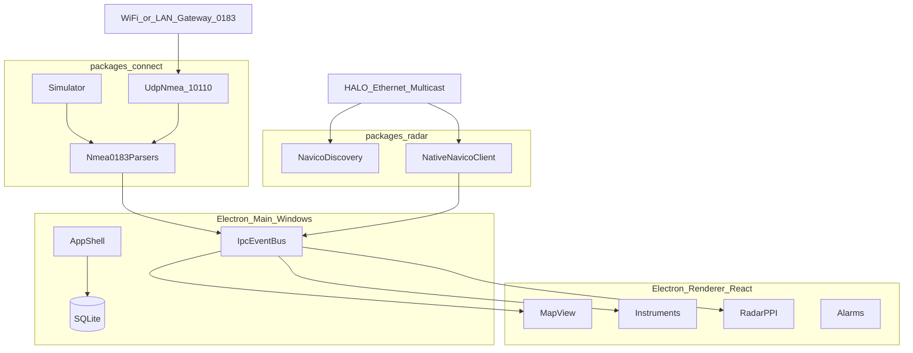

# IRBIS Detaylı Yol Haritası MD Planı

## Çıktı

Yeni dosya: [`c:\Users\Kaan\Desktop\IRBIS\IRBIS-Yol-Haritasi.md`](c:\Users\Kaan\Desktop\IRBIS\IRBIS-Yol-Haritasi.md)

Korunanlar:
- [`Teknik araştırma ve ürün mimarisi raporu.md`](c:\Users\Kaan\Desktop\IRBIS\Teknik%20araştırma%20ve%20ürün%20mimarisi%20raporu.md) — açık kaynak harita araştırması
- [`HeyCaptain-Bridge-Kilavuz-TR.pdf`](c:\Users\Kaan\Desktop\IRBIS\HeyCaptain-Bridge-Kilavuz-TR.pdf) — ürün/modül UX şablonu
- [`SEAPIR`](c:\Users\Kaan\Desktop\IRBIS\SEAPIR) — **yalnız NMEA veri alma referansı**
- [`NDATAREADER`](c:\Users\Kaan\Desktop\IRBIS\NDATAREADER) — **yalnız radar bağlanma/spoke referansı**

SEAPIR ve NDATAREADER’ın geri kalan özellikleri (UI, harita ürünü, günlük araçları vb.) IRBIS’e taşınmaz.

## Kilitlenen kararlar

- **Platform:** yalnızca Windows 10/11 x64 (dokunmatik + fare/klavye); macOS/Linux v1 kapsamı dışı
- **Kabuk / UI:** Electron + React + TypeScript + Vite (NDATAREADER zaten Electron; kabuk yeniden yazılır)
- **Harita:** tile57 aday + MapLibre GL JS; offline ENC/MBTiles
- **NMEA (Connect):** SEAPIR hattı — UDP bind `0.0.0.0:10110`, NMEA 0183 metin, envelope `{sourceIp, port, payload, ts}`, OwnShip/AIS ayrımı
- **Radar (Watch):** NDATAREADER hattı — Simrad/Navico HALO UDP multicast; native client veya Mayara sidecar; kablolu Ethernet zorunlu
- **Kalıcılık:** SQLite
- **Geliştirme sırası:** simülasyon → SEAPIR-tarzı gerçek UDP NMEA → Faz 3’te HALO radar
- **Signal K:** ikincil/opsiyonel köprü (Mayara yolu); birincil NMEA yolu SEAPIR değil Signal K değil
- **MVP dışı:** sonar, otopilot derin kontrol, CZone, SmartCraft, SEAPIR/NDATAREADER UI
- **Yasal:** seyir yardımcısı; ECDIS değil; açılış uyarısı

## Referans inceleme özeti (MD’ye gömülecek)

### SEAPIR → IRBIS Connect (NMEA)

Kaynak: `SEAPIR/lib/data/datasources/nmea/`

| Konu | Gerçek durum |
|------|----------------|
| Transport | UDP only (`RawDatagramSocket`); varsayılan port **10110** |
| Protokol | NMEA **0183** ASCII satır; native N2K/PGN yok |
| TCP | UI’da var, socket yok — IRBIS’te sonra opsiyonel |
| OwnShip | RMC (lat/lon/SOG/COG), HDG/HDT/HDM |
| AIS | !AIVDM/!AIVDO tip 1–3 (pozisyon); tip 5 yok |
| Pattern | Envelope → router (`$` / `!`) → OwnShip merge + AIS map → throttled UI |

IRBIS Connect paketinde yeniden yazılacak: aynı pipeline Node `dgram` + TypeScript parser’lar; parser seti MVP’de DBT/DPT, MWV, RSA vb. ile genişletilecek.

### NDATAREADER → IRBIS Watch (Radar)

Kaynak: `NDATAREADER/src/radar/` + `RADAR_HALO_RESEARCH.md`

| Konu | Gerçek durum |
|------|----------------|
| Marka | Simrad / Navico HALO (20/20+/24) |
| Discovery | `236.6.7.5:6878` |
| Spokes | `236.6.7.8:6678` — Gen3+ unpack, 2048 spoke/rev |
| Reports / cmds | `236.6.7.9:6679` / `236.6.7.10:6680` |
| Heading NKOE | `239.238.55.73:7527` |
| Yollar | NativeNavicoClient veya Mayara `:6502` |
| Unlock | Yok (HeyCaptain unlock modelinden farklı) |
| Ağ | Kablolu Ethernet; WiFi multicast spoke için uygun değil |

IRBIS Radar modülünde: protokol/unpack/kontrol yüzeyini referans al; PPI/IPC/UI sıfırdan React’te. Faz 3’te native path öncelikli (mevcut kod sizde); Mayara isteğe bağlı hızlandırıcı.

## MD içeriği (çok detaylı yapı)

1. Yönetici özeti
2. Ürün tanımı ve sınırlar (Chart / Connect / Watch / Record)
3. Referans matrisi — HeyCaptain (ürün), SEAPIR (NMEA), NDATAREADER (radar), açık kaynak harita projeleri; her biri için “al / alma”
4. Sistem mimarisi (Windows Electron)
5. Veri modeli
6. Harita hattı (S-57 → tile → MapLibre)
7. **Connect hattı (SEAPIR tabanlı)** — UDP 10110, cümle haritası, kaynak IP önceliği, teşhis, mock sender
8. **Radar hattı (NDATAREADER tabanlı)** — multicast tablosu, unpack, TX/range/gain, overlay, Ethernet gereksinimi
9. UI bilgi mimarisi (HeyCaptain TOC uyarlanmış; SEAPIR/NDATAREADER UI yok)
10. Faz planı
    - Faz 0: Electron+React iskelet, simülasyon, seyir uyarısı
    - Faz 1 MVP: harita + SEAPIR-pipeline NMEA/AIS + rota/iz/MOB/demir + SQLite
    - Faz 2: cümle genişletme, alarm, paketleyici (NSIS), saha NMEA testi
    - Faz 3: HALO radar (NDATAREADER native), overlay, kamera/GRIB opsiyonel
    - Faz 4+: sonar, otopilot, dijital güç — ayrı program
11. Modül backlog + kabul kriterleri
12. Riskler (multicast/WiFi, ENC lisans, tile57, Electron perf, protokol tersine mühendislik)
13. Doğrulama / sahada pilot
14. Repo yapısı — `packages/connect` (SEAPIR port), `packages/radar` (NDATAREADER port)
15. İlk 10 iş günü sprint
16. Açık sorular

## Mimari (MD içine)

## Yazım kuralları

- Türkçe, uygulanabilir, pazarlama yok
- Her fazda giriş / çıkış / yapılmayacaklar
- SEAPIR ve NDATAREADER için dosya yolları ve port tabloları açık yazılsın
- “Bu projelerin UI’sini sevmiyoruz” kararı MD’de tek cümleyle kayıtlı olsun

## Onay sonrası

Yalnızca `IRBIS-Yol-Haritasi.md` oluştur; araştırma raporuna, SEAPIR’e ve NDATAREADER’a dokunma.
