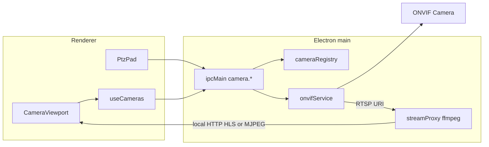

# ONVIF kamera altyapısı (ayarlar fazı hariç)

## Kapsam sınırı
- **Bu faz:** ONVIF protokol servisi, kamera registry, dual-stream modeli, IPC, canlı görüntü borusu, mevcut `CameraViewport` / PTZ bağlama.
- **Değil:** Tam Ayarlar sayfası / kamera yönetim UI. `onvif.txt`’deki “Kamera Ekle” ayarlar ekranı **sonraki faz**; burada sadece o ekranın çağıracağı API hazırlanır.
- Geçici test: IPC + küçük bir **dev/bridge hook** (mevcut kamera chip’lerinden IP/user/pass ile `cameraAdd` çağırmak). Ayrı settings route yok.

## Mevcut durum
- Kamera UI sahte: [`apps/desktop/src/App.tsx`](apps/desktop/src/App.tsx) içinde `CameraViewport` CSS placeholder.
- Electron IPC deseni hazır: [`apps/desktop/electron/main.cjs`](apps/desktop/electron/main.cjs), [`apps/desktop/electron/preload.cjs`](apps/desktop/electron/preload.cjs) (`nmeaService` gibi servis kalıbı).
- ONVIF/RTSP bağımlılığı yok.

## Mimari



## 1) Bağımlılıklar
- `onvif` (agsh) — WS-Discovery, Media `getProfiles` / `getStreamUri` / `getSnapshotUri`, PTZ.
- `ffmpeg-static` + `fluent-ffmpeg` (veya doğrudan `child_process.spawn`) — RTSP → tarayıcıda oynatılabilir yerel akış.

## 2) Main-process servisler
Yeni dosyalar:
- [`apps/desktop/electron/cameraRegistry.cjs`](apps/desktop/electron/cameraRegistry.cjs) — `userData/cameras.json` CRUD.
- [`apps/desktop/electron/onvifService.cjs`](apps/desktop/electron/onvifService.cjs) — discover / connect / profiles / stream URIs / PTZ.
- [`apps/desktop/electron/cameraStreamProxy.cjs`](apps/desktop/electron/cameraStreamProxy.cjs) — kamera başına ffmpeg proxy (visible + thermal ayrı process).

**Kamera modeli (dual stream):**
```js
{
  id, name, host, port, username, password,
  streams: {
    visible: { profileToken, rtspUrl, playUrl },
    thermal: { profileToken, rtspUrl, playUrl } | null
  },
  capabilities: { ptz: boolean },
  lastSeenAt, status
}
```
Profil sınıflandırma: profil adı / VideoSource adında `thermal|ir|flir|lwır` → thermal; aksi visible. İki profil yoksa yalnız `visible`.

**Otomatik ekleme akışı:** `Discovery.probe` → host listesi → kullanıcı (sonraki ayarlar) veya geçici hook `cameraAdd({host,user,pass})` → `connect` → profilleri çöz → registry’ye yaz → stream proxy başlat → `irbis:cameras` broadcast.

## 3) IPC + preload
`preload.cjs` / `window.irbis` genişletmesi:
- `cameraDiscover()`
- `cameraAdd({ host, port?, username, password, name? })`
- `cameraRemove(id)`
- `cameraList()`
- `cameraSetActive(id)` / `cameraSelectStream('visible'|'thermal')`
- `cameraPtz({ id, action, … })`
- `onCameras(handler)` event

`main.cjs` içinde `nmea` gibi servisi ayağa kaldır.

## 4) Renderer bağlantısı
- `apps/desktop/src/hooks/useCameras.ts` — liste + aktif kamera + stream URL.
- `CameraViewport`: placeholder yerine `<video>` (veya MJPEG ``) ile `playUrl`; chrome’da `VIS` / `THERMAL` badge; stream yoksa mevcut boş durum.
- Mevcut CAM switch / PTZ: registry’deki kameralar ve ONVIF PTZ continuousMove / stop / home.
- Dual: aktif stream türü state (`visible` | `thermal`); PiP/split aynı aktif kameranın seçili stream’ini gösterir (sonraki fazda split VIS|IR eklenebilir).

## 5) Ayarlar fazına bırakılanlar
- Tam kamera ayarları sayfası / wizard UI
- Credential vault UI, ağ arayüzü seçici UI
- Çok kameralı grid düzeni ayarı

Bu fazın API’si ayarlar ekranının tek giriş noktası olacak (`cameraDiscover` + `cameraAdd`).

## Doğrulama
- LAN’da ONVIF kamera (veya ONVIF simulator) ile discover → add → visible RTSP play.
- Thermal profili olan cihazda `streams.thermal` dolu; UI’da stream türü değiştirilebilir.
- PTZ pad ONVIF continuousMove tetikler.
- Ayarlar UI eklenmeden `cameras.json` + IPC ile kalıcılık çalışır.
