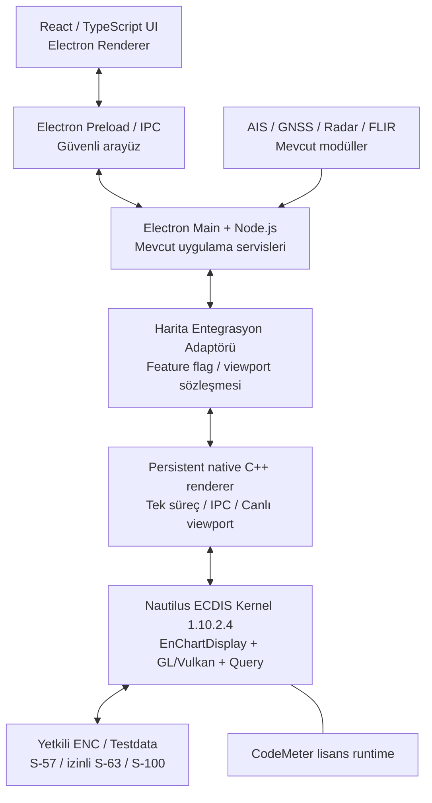

# IRBIS — Teledyne SevenCs Nautilus Kernel Entegrasyonu

> **Cursor / AI geliştirme ajanı için proje devir dokümanı**  
> **Son durum:** 5 Kasım 2026 — SDK PoC sonrası performans fazı  
> **Belge sürümü:** 2.0 — gerçek PoC sonrası performans ve persistent renderer revizyonu  
> **Proje:** IRBIS — IRMARINETECH denizcilik harita, navigasyon ve izleme masaüstü uygulaması  
> **Ana hedef:** Çalışan Nautilus ENC PoC’sini, mevcut Electron + React + TypeScript uygulamasını koruyarak **akıcı, uzun ömürlü native C++ render motoruna** yükseltmek. `PrintChart.exe` her viewport değişikliğinde tekrar çalıştırılmayacak.

---

## 0. CURSOR'A ÖNEMLİ TALİMAT — ÖNCE OKU

Bu dosya mevcut projeye ilişkin **iş bağlamını, doğrulanmış durumu, teknik kararları ve yapılacak işleri** aktarır. Geliştirme sırasında:

1. **Var olan IRBIS projesini yeniden oluşturma.** İlk önce repoyu, `package.json`, Electron main/preload, React harita bileşeni, Node.js servisleri, mevcut MapLibre entegrasyonu ve AIS/radar/kamera/NMEA modüllerini incele.
2. **Sadece harita çekirdeği katmanını kademeli değiştir.** Mevcut UI, modüler mimari, cihaz entegrasyonları, ayarlar ve işlevler korunacak. Kırıcı refactor yapma.
3. **Gerçek API'yi görmeden Nautilus sınıf/metot isimleri uydurma.** SDK'nın `include/`, `examples/`, `cmake/` ve `documentation/html/index.html` içeriği kaynak kabul edilecek. Bu belge mimari/plan belgesidir, programlama API referansı değildir.
4. **Güncel durum:** `CheckRegistration` derlenmiş, `CheckDevLicense` başarılı; `PrintChart`, `ChartViewer`, `PickReport`, `AISOverlay` örnekleri derlenmiş/çalıştırılmış, ENC Electron içinde gösteriliyor. Eski belgedeki “henüz PoC yok” ifadelerini geçersiz say.
5. **ChartServer şu ana kadar kullanıcıya teslim edilmiş değil.** Teslim edilen ve etkinleştirilen ürün **Nautilus ECDIS Kernel SDK**. ChartServer isteği ayrı takip edilebilir.
6. **Gizli/ticari dosyaları commit etme:** SevenCs SDK binary'leri, lisans dosyaları, `.WibuCmLIF` / `.WibuCmRaC` / `.WibuCmRaU`, üretici dokümanları, ticari fiyatlar, S-63 izinleri ve korumalı ENC veri kümeleri herkese açık repoya girmeyecek.
7. Her aşamada **kanıta dayalı rapor ver**: ne bulundu, ne çalıştı, hangi hata alındı, sonraki somut işlem ne. Henüz yapılmayan işleri tamamlanmış gibi yazma.
8. **PoC tamamlandı; şimdi performans darboğazını çöz.** Uzun ömürlü native C++ süreç ile render context/ENC chart library bellekte tutulsun. Electron ile Vulkan/OpenGL ortak texture entegrasyonunu doğrudan mümkün varsayma.
9. Halihazırdaki `navionics | nautilus` motor seçimi, feature flag ve çalışan PNG PoC’si **korunacak**. Eski motoru kaldırma; yeni `persistent-native` yolunu ayrı bir adapter/özellik bayrağı ile ekle ve geri dönüş imkânı bırak.
10. Üreticiyle yazışma hazırlanacaksa şirket adı **IRMARINETECH** (bitişik); yazılımın iç adı **IRBIS** ürün adı olarak dış iletişimde belirtilmesin. Toplantı önermeden yazılı teknik yanıt istenmesi tercih edilmişti.

---

## 0A. 05.11.2026 GÜNCEL SAHA DURUMU — ESKİ DURUMLARIN YERİNE GEÇER

Bu bölüm Cursor'ın `check_list.md` ilerleme raporuna ve uygulama ekran görüntüsüne dayanır. **Repo ve çalışan binary'ler doğrulanmadan yeni geliştirmeyi bitmiş sayma**; aşağıdakileri mevcut raporlanmış durum kabul et.

| Alan | Güncel raporlanan durum |
|---|---|
| SDK + CodeMeter | Nautilus ECDIS Kernel **1.10.2.4**, Development lisansı `CheckDevLicense` SUCCESS |
| C++ örnekleri | `CheckRegistration`, `PrintChart`, `ChartViewer`, `PickReport`, `AISOverlay` Release derlendi / test edildi |
| Qt | `C:\Qt\5.15.2\msvc2019_64` ile ChartViewer çalışıyor (yerel ortamda gerçek yolu kontrol et) |
| ENC test | GB test hücresi Cairo ile PNG'ye render ediliyor; interaktif Qt pan/zoom çalışıyor |
| Sorgu | `PickChart` headless ENC sorgusu → JSON |
| IRBIS/Electron | `nautilusBridge.cjs`, yerel `:18768` PNG sunucusu, `NautilusViewport`, `mapEngineStore` motor seçimi |
| Mevcut overlay | AIS / GNSS / radar görselleri **React üst katmanında**; Nautilus native overlay değil |
| Cache | Diskte z/x/y benzeri PNG cache var, `CACHE HIT` çalışıyor; ancak gerçek küçük-karolu XYZ motoru değil |
| Ana sorun | İlk yeni viewport/karo isteğinde `PrintChart.exe` yeniden başlıyor; raporlanan **yaklaşık 3–5 saniye**; CSS zoom sonrası büyük kare/snap hissi |
| Yapılmamış | Kalıcı çalışan native renderer, hızlı etkileşimli frame aktarımı, gerçek GPU/HWND entegrasyonu, ChartServer |

**Kritik karar:** `PrintChart` ile tek tek PNG oluşturma **doğrulama PoC'si olarak başarılıdır; üretim harita motoru olarak devam ettirilmemelidir**. Devam eden görev **Nautilus SDK'yı tek sefer açıp işlemi sürdüren C++ renderer** geliştirmektir.

## 0B. ÜRETİCİ ÖNERİSİ İLE BİZİM MİMARİ TERCİHİMİZİ AYIR

- **Teledyne SevenCs'in doğruladığı / önerdiği:** Özel/offline Windows navigasyon uygulamasında **Nautilus ECDIS Kernel SDK**, C++/C# native entegrasyon; Nautilus'un OpenGL/Vulkan ve farklı render hedefleri; Qt `ChartViewer` örneğinin etkileşimli viewport yaklaşımı. Web harita servisi için ayrı ürün **Nautilus ChartServer**.
- **Bu belgenin mühendislik önerisi (üreticinin Electron referans mimarisi değildir):** Mevcut `PrintChart.exe` spawn zinciri yerine **kalıcı çalışan C++ proses + bellekte tutulan Nautilus chart/display/render state + IPC + ardışık/asenkron frame aktarımı** kurmak. İlk adımda offscreen frame'i kontrollü aktar; performans gerektirirse OpenGL/Vulkan hedefleri araştır. ChartServer zorunlu olduğu sonucu çıkmaz.
- **Doğrulanacak:** API lifecycle, yüzey hedefleri, render çıkış formatı, Windows/Chromium ile hızlı paylaşım, lisansın işlem sayısı sınırı, Electron uyumluluğu ve gerçek FPS/gecikme. Doğrudan Vulkan `VkImage` ile Electron'a zero-copy aktarım mümkün olduğu **varsayılmayacak**.

---

## 1. PROJE NEDİR, HEDEFİMİZ NE?

IRMARINETECH bünyesinde geliştirilen IRBIS, Windows üzerinde çalışan profesyonel bir denizcilik harita ve durumsal farkındalık uygulamasıdır. Amaç, Simrad/Garmin tarzı chartplotter deneyiminin PC'de; modern bir kullanıcı arayüzü ve farklı sensörlerle bir arada sunulmasıdır. İlk öncelikler arasında liman/kıyı güvenliği ve deniz trafiği izleme vardır; zaman içinde tekne/seyir navigasyonu ve gelişmiş rota fonksiyonlarına büyümesi hedeflenir.

### Mevcut / önceden geliştirilmekte olan teknoloji seti

- Masaüstü kabuk: **Electron**.
- Arayüz: **React + Vite + TypeScript**, gerektiğinde JavaScript.
- Masaüstü/cihaz/servis katmanı: **Node.js / Electron main process**.
- Önceki harita yaklaşımı: **MapLibre GL JS** ve/veya yerel tile/harita servisleri.
- İlgili modüller: GNSS/NMEA 0183, AIS, radar verisi/kontrol çalışmaları, FLIR kameralar/görüntüleme/kontrol, harita üzerindeki etkileşimler. Her birinin bugünkü uygulama durumunu **repo incelemesi** belirleyecek; bu liste tümünün üretimde tamamlandığını iddia etmez.
- Hedef platform: **Windows x64**, çoğunlukla **offline veya izole ağ**.
- Ana uygulama kullanıcı arayüzü Türkçe, modern, sade; geliştirilen mevcut tasarım korunacak.

### Yeni hedef

Deniz haritasını sıfırdan S-52/S-63/S-100 uyumlu render etmeye uğraşmak yerine **Teledyne SevenCs Nautilus ECDIS Kernel**'in aşağıdaki yeteneklerinden yararlanmak:

- S-57 ENC görüntüleme ve S-52 portrayal.
- İzinli/şifreli S-63 ENC verisini içe aktarma/yönetme.
- S-101 ve diğer uygun S-100 veri ürünleri; kesin aktif modüller lisans + SDK ile doğrulanacak.
- Pan, zoom, rotation, projection, koordinat dönüşümleri.
- Harita objesi/özellik/derinlik sorguları (`PickReport`, `DangerHighlight` vb.).
- Gerekirse AIS, ARPA, rota ve özelleştirilmiş coğrafi overlay mekanizmaları.
- Yerel/offline kullanım ve ticari sürümde lisanslı paketleme.

**Yazılım bütünüyle C++/C#'a taşınmayacak.** Gerekli native katman yalnızca harita/SDK erişimini sağlayacak. İlk PoC'de mümkün olan en az değişiklik hedeflenecek.

---

## 2. TELEDYNE SEVENCS İLE YAZIŞMA — KRONOLOJİ

### 2.1 İlk teknik görüş alışverişi (Ekim 2026)

- IRMARINETECH, S-57 / Türkiye S-63 ENC, gelecekte S-100, Windows/offline kullanım ve Electron/React tabanlı özel UI için **Nautilus Kernel SDK ile Nautilus ChartServer** seçeneklerini araştırdı.
- 27 Ekim 2026 tarihli ayrıntılı teknik soru listesi hazırlandı ve SevenCs'e iletildi.
- Üretici Bryan ve Stefan ile yazışmalar yürütüldü; yazılı yanıt ve değerlendirme erişimi talep edildi.
- SevenCs soruların büyük çoğunluğunu yanıtladı; birkaç noktada teknik ekipten ayrıca açıklama gerektiğini belirtti.

### 2.2 Üreticinin kesinleşen ürün ayrımı

| Konu | Nautilus ECDIS Kernel SDK | Nautilus ChartServer |
|---|---|---|
| Temel rol | Geliştiricinin kendi ENC/navigasyon uygulamasını oluşturduğu **SDK** | Nautilus SDK üzerine geliştirilmiş **hazır harita sunucusu** |
| Mevcut UI'yi özelleştirme | Daha yüksek esneklik | Web/OGC servis istemcisi yaklaşımı |
| Native C++ / C# | C++ arayüzü, C# wrapper olduğuna dair üretici yanıtı | Normalde WMS/servis/API tüketimi |
| Offline tek PC | Uygun | Yerel servis olarak çalışabileceği doğrulandı |
| IRBIS'in gelecekteki gelişmiş navigasyon hedefi | **Üreticinin öncelikli önerisi** | Sadece arka plan ENC + AIS katmanları için daha pratik olabilir |
| Ücretsiz deneme | **60 gün** | **30 gün** |
| Teslim durumu (05.11.2026) | **İndirildi, kuruldu, CodeMeter aktive edildi** | **Henüz alındığı doğrulanmadı** |

Bryan'ın özeti: Kernel kendi uygulamanızı kurmanıza yarar; ChartServer SDK üzerinde hazırlanmış hazır bir ürün; tercih **make-or-buy** kararıdır. Her ikisinin değerlendirilmesi mümkündür. Ancak ikisini aynı anda üretim mimarisinde kullanmak özel gerekçe yoksa gereksiz karmaşıklık getirebilir.

### 2.3 Teknik soru-cevap belgesinden kritik netlikler

- **Kernel, ana pencerenin tümünü sahiplenmek zorunda değil:** hedef bir widget, image/surface gibi render yöntemleri açıklanıyor.
- **Render seçenekleri:** Cairo, OpenGL, Vulkan; offscreen image; Qt `QImage` / `QPixmap`; Vulkan External Target / `VkImage` bilgisi belgelenmiş.
- **Electron/React entegrasyonu mümkün yaklaşım:** native **C++ / C# köprü veya yerel servis** düşünülebilir. **Ancak üreticinin resmî Electron/React referans mimarisi yok.**
- **MapLibre kararı:** SevenCs ana ENC viewport'u Nautilus'un render etmesini öneriyor. MapLibre'ı overlay/etkileşim katmanı olarak kullanmanın uygulanabilirliği özel mimari ve performans testine bağlı.
- **ENC:** S-57/S-63 + lisanslı izinler; chart library, datum/koordinat, feature query, pick report, update yönetimi.
- **Türkiye S-63:** geçerli izin ve lisanslarla işlenebilir. Doğrudan S-63 OEM çözümü için IHO anlaşması, Manufacturer ID (M-ID), Manufacturer Key (M-Key) gibi gereklilikler doğabilir. Bu yükümlülük SDK'nın otomatik kaldırdığı bir konu değil.
- **Offline:** izinler ve lisanslar sağlandıktan sonra internet bağlantısı olmadan kullanılabilir.
- **S-100:** S-101/S-102/S-104/S-111 modüllerinden söz edildi; S-57 ile S-100'ü birlikte kullanmaya yönelik 'dual-fuel' yaklaşımı var. Kullanılabilirlik, verinin test/üretim niteliği, sürüm ve runtime modülleri ayrıca teyit edilecek.
- **Overlay:** AIS, ARPA, Own Ship, rotalar, waypoint, radar akışı ve özel geospatial katman örnekleri var. FLIR'a özgü hazır footprint olmadığı belirtildi; özel overlay olarak geliştirilebilirliği test edilmeli.
- **Dağıtım:** CodeMeter runtime + Nautilus kitaplıkları ve gerektiğinde Chart Installer; runtime lisansı her kurulan son sistem için gerekli olabilir.
- **Üretim lisansları:** perpetual runtime seçeneği; bakım yenilenmezse yüklenmiş sürüm çalışabilir, destek/güncellemeler farklılaşır. Grafik/SDK lisansı ile ENC veri kullanım hakkı aynı şey değildir.

### 2.4 Deneme paketinin gönderilmesi (4–5 Kasım 2026)

SevenCs Support tarafında **Tejomanvitha Bathula**, Stefan'ın talebiyle **Nautilus ECDIS Kernel evaluation** paketinin indirme bağlantısını ve kurulum talimatını gönderdi.

Gönderilen pakette kullanıcının ekran görüntülerinde şu öğeler görüldü:

- `nautilusecdiskernel-1.10.2.4-windows` (Windows installer)
- `nautiluschartinstaller-1.11.2.4-windows` (ayrı Chart Installer)
- `NautilusInstallationGuide1.10.2.pdf`
- `NautilusReleaseNotes1.10.2.pdf`

> **DİKKAT:** `nautiluschartinstaller` **ChartServer değildir**. Bu, harita verilerini Nautilus sistemine kurmak/yönetmek için ayrı yardımcı araçtır. ChartServer'ın 30 günlük değerlendirme paketiyle karıştırılmamalı.

### 2.5 Lisans süreci ve teyit edilen son durum

1. SDK indirilip Windows bilgisayara kuruldu.
2. Wibu **CodeMeter Control Center** kurulmuş/çalışıyor.
3. SDK `CodeMeter` klasöründeki **`SevenCs-CmAct-VM.WibuCmLIF`** içeri aktarıldı.
4. CodeMeter'da **SevenCs CmContainer (VM)** oluşturuldu; önce `Empty license container` durumu görüldü.
5. `License Update → Create license request` akışıyla **`.WibuCmRaC`** lisans istek dosyası üretildi ve SevenCs'e e-postayla gönderildi.
6. SevenCs Support, karşılık olarak **`.WibuCmRaU`** aktivasyon dosyasını iletti.
7. Kullanıcı bu güncellemeyi CodeMeter'a import etti. Son ekran görüntüsünde **`Status: License activated`** ve **`CodeMeter service is running`** görünüyor.
8. **Güncelleme (05.11.2026):** Sonradan `CheckRegistration` derlenerek `CheckDevLicense` SUCCESS alındı. Evaluation lisansında Production testi başarısız olması beklenen davranıştır.

Bu kronolojiye ek olarak bazı örnekler başarıyla derlendi/çalıştırıldı (bkz. **0A**). Tüm modüllerin veya üretim runtime lisansının doğrulandığı anlamına gelmez. Lisansın geçerlilik tarihini CodeMeter/WebAdmin üzerinden kontrol et; tahmini tarih yazma.

---

## 3. BİLGİSAYARDAKİ GERÇEK KURULUM DİZİNİ

Kullanıcı SDK'yı varsayılan `C:` yerine **`K:` diskine** kurmuştur:

```text
K:\SevenCs\Nautilus\1.10.2.4\
```

Kurulu klasörler kullanıcı ekran görüntüsünde **görüldü**:

```text
K:\SevenCs\Nautilus\1.10.2.4\
├── bin\               # DLL ve hazır araçlar
├── cmake\             # Nautilus CMake entegrasyon dosyaları
├── CodeMeter\         # Lisans konteyneri başlangıç dosyası vb.
├── documentation\     # Programming Guide, Deployment Guide, Doxygen
├── examples\          # Kaynak kodlu örnekler
│   ├── console\
│   │   ├── CheckRegistration\
│   │   ├── ENCStatusReport\
│   │   ├── ImportData\
│   │   ├── PrintChart\
│   │   ├── RouteCheck\
│   │   ├── ShowCell\
│   │   ├── VulkanTest\
│   │   └── WorldMap\
│   ├── portrayal\
│   └── CMakeLists.txt
├── include\           # C++ public headers
├── lib\               # Link kitaplıkları
├── licenses\
├── plugins\
├── runtime\
├── src\               # Qt painter/widget kaynakları
└── testdata\          # SDK test verileri; içerik incelenecek
```

**İlk ekran görüntüsü** `examples/console/CheckRegistration` içinde `main.cpp` ve `CMakeLists.txt` olduğunu doğruladı. **Güncel durum:** Cursor bu örneği derledi ve development lisans testi başarılı; bkz. Bölüm **0A**.

SDK'nın kurulum kılavuzuna göre ilgili dokümantasyon genellikle şu dizinlerdedir (gerçek kurulu içeriği yerinde doğrula):

```text
K:\SevenCs\Nautilus\1.10.2.4\documentation\pdf\NautilusProgrammingGuide.pdf
K:\SevenCs\Nautilus\1.10.2.4\documentation\pdf\NautilusDeploymentGuide.pdf
K:\SevenCs\Nautilus\1.10.2.4\documentation\pdf\NautilusBackgroundInformation.pdf
K:\SevenCs\Nautilus\1.10.2.4\documentation\html\index.html
```

Ürünün genel kütüphane adları (gerçek dosya uzantıları, konum ve sürüm varyantlarını kontrol et):

- `NautilusCore`
- `NautilusCairo`
- `NautilusGL`
- `NautilusVk`
- `NautilusSQL`
- `NautilusPQ`

**Önemli:** Kurulum kılavuzlarındaki eski `C:\SevenCs\...` örneklerini körü körüne kullanma. Bizde kök dizin `K:\SevenCs\Nautilus\1.10.2.4`.

---

## 4. GÖNDERİLMİŞ / KULLANICI TARAFINDAN SAĞLANACAK BELGELER

Cursor'a kullanıcı tarafından ayrıca verilecek kaynakları incele:

| Dosya | İçerik | Kullanım |
|---|---|---|
| `Nautilus_Technical_Evaluation_Answered.docx` | IRMARINETECH'in 36 sorusuna SevenCs yanıtları | Ürün seçimi, render, lisans, özel UI ve mimari kararları |
| `Nautilus_ProductInformation_1.8_Mar2025.pdf` | Mart 2025 Kernel SDK ürün bilgisi | Genel özellikler, modüller, lisans yaklaşımı; **daha eski sürüm belgesi** |
| `TeledyneSevenCs-NautilusChartServer-ProductInformation.pdf` | Haziran 2026 ChartServer ürünü | ChartServer karşılaştırması; ürünün kurulu olduğunu göstermez |
| `NautilusInstallationGuide1.10.2.pdf` | Kurulum, CodeMeter, örnek proje derleme | **Mevcut kurulum için öncelikli referans** |
| `NautilusReleaseNotes1.10.2.pdf` | 1.10.x sürüm değişiklikleri | SDK özellikleri/hata düzeltmeleri ve sürüm uyumu |
| SDK kurulum içindeki `documentation/html/index.html` | Doxygen API belgeleri | **Sınıf ve fonksiyonlar için birincil kaynak** |
| SDK kurulum içindeki `documentation/pdf/NautilusProgrammingGuide.pdf` | SDK programlama açıklamaları | Çalışan entegrasyon ve render yöntemleri |
| SDK `examples/**` | Gerçek örnek C++ kaynak kodu | **PoC geliştirme için birincil kaynak** |

Belgeler SevenCs tarafından **gizli / ticari açıdan hassas** olarak işaretlenmiş olabilir. Yerel çalışma alanında incele; lisans koşullarını kontrol etmeden yayımlama.

### Doküman/sürüm farklarına dikkat

- Mart 2025 ürün broşüründe SDK sürümü **1.8** anlatılıyor; gerçekte yüklenen SDK **1.10.2.4**.
- Haziran 2026 ChartServer bilgi dokümanındaki ürün/sürüm modülleri ile soru-cevap belgesindeki ifadeler birebir aynı olmayabilir.
- 1.10.2 Release Notes içindeki standartlar tablosunda sürüm başlığından farklı bir kernel sürümü ifadesi olabilir; *belge içindeki ifade/sürüm tutarsızlıklarını* işletim ortamında doğrulamadan yorumlama.
- Release Notes'ta bir standardın listelenmesi, o modülün mevcut evaluation lisansında etkin ya da ticari kullanımının koşulsuz olduğu anlamına gelmez.

---

## 5. YENİ ÖNCELİK — PERSISTENT C++ NAUTILUS RENDERER (ŞİMDİ BUNU YAP)

**Neden:** Şu anki akış `Electron -> spawn PrintChart.exe -> Nautilus init -> ENC yükle -> Cairo çiz -> PNG yaz -> process exit`. Her yeni hücre/viewport için yeniden başlatma nedeniyle ilk render yaklaşık 3–5 saniye sürüyor. Disk cache yalnızca aynı kareye ikinci dönüşü hızlandırıyor. Büyük tek PNG + CSS scale + zoom sonunda snap yaklaşımı gerçek chartplotter deneyimi vermiyor.

**Hedef:** IRBIS'in mevcut Electron + React ekranı aynen kalırken yalnızca harita altyapısı değişecek. **Tek/uzun ömürlü C++ render süreci**, Nautilus'u, chart library'yi, render context'i ve `EnChartDisplay` benzeri canlı viewport state'ini **bir kez oluşturup tekrar kullanacak**. Pan/zoom/rotation sırasında süreç tekrar başlatılmayacak.

### Aşama P0 — Önce gerçek SDK kaynaklarını oku ve repo durumunu tespit et

1. `K:\SevenCs\Nautilus\1.10.2.4\examples\portrayal\ChartViewer`, `PrintChart`, `PickReport`, `include/`, `documentation/html/index.html`, `NautilusProgrammingGuide.pdf` kaynaklarını incele.
2. `ChartViewer` içinde **chart library load**, renderer/chart display yaşam döngüsü, viewport güncelleme, repaint, hit-testing ve OpenGL/Vulkan render hedeflerini bul. İsimleri gerçek headers/Doxygen ile doğrula; uydurma API kullanma.
3. IRBIS içindeki `nautilusBridge.cjs`, `NautilusViewport`, `mapEngineStore`, `PickChart` ve `:18768` sunucusunu bul. Akışı, cache anahtarlarını, performans loglarını ve lifecycle'ı doğrula.
4. **Mevcut çalışan PoC'yi silme.** Yeni akışı `persistent-native` şeklinde opt-in/feature flag ile geliştir; Navionics/Nautilus seçimlerini bozma.

### Aşama P1 — Kalıcı çalışan bağımsız C++ servis

1. SDK'nın kurulu dizinine dokunmadan **IRBIS repo içinde ayrı bir C++/CMake modülü** oluştur. Gerçek örneği temel alan bir native executable/service üret.
2. Süreç açılışta **bir kez** SDK lisansını doğrulasın, örnek ENC kütüphanesini yüklesin, render/chart context oluştursun. Sonraki viewport isteklerinde bunları sıfırdan yaratmasın.
3. İlk prototipte bir adet yerel foreground chart viewport yönet. Sonraki ihtiyaçta çoklu viewport için performans ve lisans sınırlarını ayrı incele. CodeMeter Error 212 yaşandığı için eşzamanlı çok sayıda ayrı `PrintChart` process çalıştırma.
4. Process yaşam döngüsü: `start -> initialize -> loadChart -> setViewport -> render -> pick -> setPalette -> shutdown`. Bunlar **önerilen IPC komut isimleri**, Nautilus SDK API isimleri değildir.
5. Kendi thread-safety modelini SDK dokümanına göre belirle; viewport taleplerini gerekiyorsa seri işle, yalnızca en güncel isteği görüntüle ve eski tamamlanan render karelerini UI'ye basma.
6. Hata durumunda renderer kapanış/log/yeniden başlatma ve eski motor fallback'i sağlam olsun; lisans mekanizmasını atlatma.

### Aşama P2 — Electron/React'e viewport + frame IPC

1. Electron main prosesinden native child process'i **tek sefer başlat ve yaşat**; preload üzerinden yalnızca sınırlı/güvenli IPC aç. `nodeIntegration` veya uzaktan erişilebilir kontrol uç noktalarını kontrolsüz biçimde açma.
2. Kontrol mesajlarına `requestId`, `viewportRevision`, merkez (lat/lon), bbox/scale, rotation, pixel width/height, DPI ve palette bilgisi ekle; derece/radyan ve projeksiyon sözleşmesi açık olsun.
3. **Birinci çalışan sürüm:** Offscreen render edilmiş frame'i PNG / binary buffer / memory-mapped dosya veya named pipe ile teslim et. **Tercih gerçek SDK ve benchmark'a bağlı.** Mevcut localhost PNG sunucusu ilk taşıma kanalı olarak korunabilir ancak uygulama performansını sınırladığı ölçülmeli.
4. Her mousemove için ağır full render zorlamadan hızlı görsel önizleme + uygun sıklıkta yeni frame üret. Pointer hareketi ve yakınlaştırma sırasında son iyi kare **ekranda kalsın**, boş ekran veya sürekli “karo yükleniyor” çıkmasın; yeni frame geldiğinde doğru viewport ile güncellensin.
5. **Pan, zoom, rotation, resize** yalnızca native'de değil React UI, hit-testing (`PickReport`), AIS/own-ship overlay ve koordinat dönüşümünde de eşzamanlı kalmalı. Render sonucundaki coğrafi extent/revision'ı UI ile paylaş.
6. `PrintChart` ile PNG tile üretimini yalnızca **fallback, export, offline bake veya test** için bırak. Etkileşimli haritanın ana render döngüsü haline getirme.

### Aşama P3 — Performans iyileştirme, sonra GPU yolu

- Baseline logla: **ilk `PrintChart` cache miss ~3–5 sn** (mevcut rapor), cache hit, pan/zoom algılanan gecikme, frame süresi, RAM/CPU/GPU ve SDK ilk yükleme maliyeti.
- Yeni motorun **ilk açılış** ve **sonraki 20 ardışık pan/zoom** ölçümlerini ayrı tut. İlk açılışın yavaş olması ile her karede yavaş olması farklı sorunlar.
- Bellekte güncel/komşu frame tutma, viewport request coalescing, son istek önceliği, erken/arka plan render, küçük bölge/tile prefetch **ölçümle anlamlıysa** uygula.
- **Gerçek tile pyramid** isteniyorsa standart tile grid, stabil zoom/bbox/projection, komşu tile prefetch ve cache eviction tasarla; z/x/y adını kullanmak tek başına gerçek XYZ/TMS motoru değildir.
- Mevcut Cairo/offscreen yolundan performans sınırına gelinirse **Nautilus OpenGL/Vulkan render** seçeneklerini araştır. Native HWND child/embed ve Vulkan external image/texture paylaşımı ancak Windows + Electron/Chromium uyumluluğu kanıtlandıktan sonra seçilsin; **zero-copy varsayma**.
- ChartServer **şart değil**. Eğer Kernel ile kabul edilebilir pan/zoom sağlanamazsa 30 günlük ayrı ChartServer denemesini istenen mimari için alternatif PoC olarak değerlendirebiliriz.

### Aşama P4 — Kabul kriterleri

- [ ] Native proses **20+ pan/zoom** işleminde yeniden spawn olmadan açık kalıyor; chart library tekrar tekrar yüklenmiyor.
- [ ] Gerçek viewport/render state **tek native otorite** üzerinden yönetiliyor; React AIS/own-ship koordinatları ile harita hizası korunuyor.
- [ ] Hızlı mouse/zoom hareketlerinde **eski frame yeni viewport'un üstüne geçmiyor** (revision veya request ID kontrolü).
- [ ] Kullanıcıya boş ekran/yanlış fit/zoom snap olmadan akıcı geçiş sağlanıyor; eski görüntü yeni render gelene dek korunuyor.
- [ ] `pickFeature` gerçek ENC nesnesini doğru coğrafi/screen koordinatında döndürüyor.
- [ ] Offline, CodeMeter ve güvenli paketleme kısıtları korunuyor; SDK/lisans dosyaları repoya girmiyor.
- [ ] **Ölçülmüş** eski/yeni gecikme karşılaştırması ve ekran kaydı/screenshots çıktı olarak sağlanıyor. Hedef sayılar testten önce başarı gibi yazılmıyor.

### Cursor'dan beklenen ilk somut teslim

1. `NAUTILUS_PERSISTENT_RENDERER_DESIGN.md`: mevcut darboğazın repo/doküman kanıtı, gerçek SDK API'leri, proses + IPC + frame transport tasarımı.
2. `native/nautilus-renderer/` benzeri ayrı, derlenen **kalıcı C++ servis** ve build talimatı; mevcut kod stiline göre adlandır.
3. Electron main/preload ile güvenli IPC ve mevcut `NautilusViewport` içine feature flag üzerinden bağlantı.
4. `NAUTILUS_RENDER_BENCHMARK.md`: 3–5 saniyelik mevcut yol ve yeni yöntem için gerçek ölçümler; başarısız test/hatalar dahil.
5. Geri dönüş/fallback çalışıyor; mevcut Navionics ve PrintChart PoC bozulmamış.

**Uygulama komutu:** Bu planı sadece teori olarak raporlama; **doğru SDK kodunu inceleyip erişebildiğin ortamda uygulayarak, derleyerek ve test ederek ilerle.** Bir adım gerçek API veya lisans engeline takılırsa kısaca kanıtla, alternatif yolu dene ve sonucu belirt.

---

## 6. ÖNERİLEN HEDEF MİMARİ



> Bu **önerilen uygulama mimarisidir**. Teledyne Kernel ve C++/C# entegrasyon yaklaşımının fizibilitesini doğruladı; özel persistent Electron IPC/texture mimarisini resmî olarak onaylamış değildir. Yukarıdaki akışın spesifik IPC/texture/port tasarımı henüz uygulama üzerinde doğrulanmamıştır.

### Katman sorumlulukları

| Bileşen | Sorumluluk | Değişiklik |
|---|---|---|
| React/Vite/TS | UI, paneller, harita kullanıcı etkileşimleri | **Korunur**, adaptör bağlanır |
| Electron main/preload | native süreç yaşam döngüsü, güvenli IPC, uygulama packaging | **Korunur**, modül eklenir |
| Node.js servisleri | cihaz/sensör haberleşmesi, durum ve log yönetimi | **Korunur** |
| `MapEngineAdapter` (mevcut/evrilen) | Nautilus / Navionics / persistent native arasında güvenli geçiş; viewport API | **Yeni** |
| Persistent C++ renderer | Tek uzun ömürlü SDK oturumu, chart library, viewport, frame transport, nesne sorguları | **Yeni** |
| Nautilus SDK / CodeMeter | ENC işleme, render, lisans kontrolü | **Harici ticari bağımlılık** |
| Mevcut MapLibre | Geçiş fallback'i veya bazı altlıklar | Test bitene kadar kaldırma |

### Önerilen TypeScript soyutlama sözleşmesi (Nautilus API değildir)

```ts
export type GeoPosition = { longitude: number; latitude: number };
export type MapViewportState = {
  center: GeoPosition;
  widthPx: number;
  heightPx: number;
  rotationDeg: number;
  scale?: number;
};

export interface MapEngineAdapter {
  initialize(): Promise<void>;
  setViewport(viewport: MapViewportState): Promise<void>;
  pickFeature(screenX: number, screenY: number): Promise<unknown[]>;
  setPalette(palette: 'day' | 'dusk' | 'night'): Promise<void>;
  dispose(): Promise<void>;
}
```

Bu sözleşme **ön taslak**; repo mimarisi, gerçek SDK örnekleri ve koordinat/ölçek temsili incelenince kesinleştirilecek. Native kodu bu sözleşmeye uydurmak için SDK davranışını zorlamaya çalışma.

---

## 7. NATIVE KÖPRÜ: C++ MI C# MI?

- **C++:** Nautilus'un native API ve `ChartViewer` örneklerine en yakın yol. **Persistent renderer görevinde ana ve önerilen uygulama dili C++**.
- **C#:** Üretici C# wrapper olduğunu belirtiyor. Bilgisayarda gerçekten hangi wrapper/assembly ve örneklerin teslim edildiğini `documentation`, `bin`, `examples` üzerinden doğrula. C# ile Windows hizmet/IPC geliştirmesi kolaylaştırılabilir.
- **Sadece JS/TS:** Nautilus **Kernel için belgelenmiş doğrudan JS API'si teyit edilmedi**. Native bridge olmadan Kernel'in her işlevine erişebileceğimiz varsayılmamalı. Buna karşılık gelecekte ChartServer verilirse JS/HTTP servis tüketimi denenebilir.
- **Qt:** Verilen C++ GUI örneklerinin bağımlılığıdır. Kullanıcı arayüzünü Qt'ye taşıma kararı değildir.

**Güncel:** `CheckRegistration`, `PrintChart`, `ChartViewer` ve `PickReport` PoC tamamlanmış durumda. Sonraki iş basit CLI denemesini tekrarlamak değil, `ChartViewer` yaşam döngüsünden kalıcı servis oluşturmaktır.

---

## 8. ENC / S-63 LİSANSLAMA SINIRLARI

- Testin ilk aşamasında SDK `testdata` veya yeniden dağıtımına izin verilen açık örnek harita verilerini kullan.
- Kullanıcının Türkiye S-63 veri seti ayrıca mevcut olabilir; **geçerli izinler/Cell Permits/User Permit/Manufacturer Key ve chart-data lisansı** olmadan şifre çözmeye veya ithal etmeye kalkma.
- S-63 şifresini/korumayı atlatan kod yazma. Sağlayıcının meşru iş akışını takip et.
- Lisans aktivasyonu için CodeMeter kullanılıyor. CmAct lisans cihaz/VM koşullarına bağlı olabilir; geliştirme ortamının disk/VM özelliklerini rastgele değiştirme.
- SDK binary dosyaları ve ticari evraklar geliştirici makinede kalmalı; CI/CD ve dağıtım aşamasında ayrıca SevenCs sözleşmesi incelenecek.
- Bu geliştirme **ECDIS tip sertifikalı bir ürün yaratıldığını** göstermez. Yalnızca SDK'nın uygun standart desteği olabilir; sertifikasyon ayrı süreçtir.

---

## 9. PERFORMANS VE DOĞRULAMA KRİTERLERİ

Aşağıdaki değerler **hedef değil ölçülecek metriklerdir**; sabit FPS/latency taahhüdü değildir. Mevcut PrintChart cache MISS için raporlanan 3–5 saniye yeni motorun karşılaştırma bazıdır, doğrudan Nautilus Kernel performansının üst sınırı değildir.

| Test | Nasıl doğrulanacak |
|---|---|
| Lisans kontrolü | `CheckRegistration` çalışıyor, CodeMeter runtime valid |
| İlk ENC render | SDK testdata ile görüntü üretiliyor |
| Pan/zoom/rotate | UI komutları doğru koordinat/extent'e yansıyor |
| Feature query | Tıklama → gerçek ENC özellikleri ve öznitelikleri |
| Çoklu overlay | AIS örnek hedefleri doğru coğrafi konumda |
| Offline açılış | İnternetsiz başlatmada lisans ve veri izinleriyle çalışıyor |
| Performans | `PrintChart` yeniden spawn süresi vs. persistent render; frame latency, dropped/stale frame, CPU/GPU/RAM |
| Yeniden boyutlandırma | Windows DPI, çoklu monitör, Electron window resize |
| Süreç dayanıklılığı | Native bridge kapanırsa kontrollü hata, restart/fallback |
| Güvenli paketleme | SDK/lisans sırları repoya girmez; runtime şartları kontrol edilir |

UI ile native viewport karşılaştırmalarında koordinat sistemleri, derece/radyan ve ölçek birimlerinin tek ve açık sözleşmesi bulunmalı. Hedef performans değerleri gerçek donanım üzerinde ölçülüp kullanıcıyla belirlenecek.

---

## 10. GÜNCEL EKSİKLER / RİSKLER (05.11.2026)

1. **Performans kritik açık:** Native persistent renderer henüz yok; `PrintChart.exe` her yeni tile için yeniden çalışıyor (ilk istek ~3–5 sn).
2. **Geçici çözüm:** Tek büyük PNG + CSS pan/zoom + settle/snap. Disk cache gerçek ama Navionics hissi henüz yok.
3. **GPU frame aktarımı:** Offscreen/GL/Vulkan/HWND seçenekleri Electron üzerinde henüz benchmark/entegrasyonla kanıtlanmadı.
4. **ChartServer paketi teslim edilmedi**; ChatServer ile Chart Installer karıştırılmamalı. İleride alternatif test edilebilir.
5. **Türkiye S-63 kullanım izinleri**, CodeMeter ticari runtime, IHO OEM koşulları ve harita veri hakları ayrı kontrol edilecek.
6. **Chart Installer 1.11.2.4 / Kernel 1.10.2.4** uyumluluğu belge veya üreticiyle kontrol edilecek; sürüm farkı tek başına hata sayılmaz.
7. **S-100 modülleri**, ürün sürümü ve evaluation/runtime lisansına göre doğrulanacak.
8. **AIS / GNSS / radar** şu anda React üst katmanında. Native ENC ile viewport/projeksiyon/heading tutarlılığı zorunlu; ileride SDK native overlay'e geçiş ihtiyaç bazlı.
9. **Demo/ölçüm:** Basit Qt `ChartViewer` pan/zoom performansı ile headless servis performansını aynı donanımda karşılaştır; render hedefi ve grafik sürücüsü farkını belgeleyerek raporla.
10. **Üretici belgeleri gizli:** SDK DLL, header, token, permit, license ve özel ürün PDF'lerini herkese açık repoya ekleme.

---

## 11. CURSOR'IN BU AŞAMADA TESLİM ETMESİ GEREKENLER

- [x] `NAUTILUS_PERSISTENT_RENDERER_DESIGN.md` — gerçek `ChartViewer`, Doxygen, SDK header kanıtları ve IPC tasarımı.
- [x] CMake ile derlenen **persistent C++ Nautilus renderer**, ayrı repo modülünde (`native/nautilus-renderer`).
- [x] `Electron main/preload → persistent renderer → React` entegre; mevcut `navionics`/`nautilus` seçenekleri bozulmadan (`nautilusBridge` feature flag + PrintChart fallback).
- [ ] Mouse pan, wheel zoom, rotation, resize ve `pickFeature` senkronize; hızlı ardışık istekte stale frame oluşmuyor.
- [ ] Cache miss durumunda dahi eski frame görünür; kullanıcı her harekette “yükleniyor”/boş harita görmüyor.
- [ ] `NAUTILUS_RENDER_BENCHMARK.md` — aynı viewport/hardware için **eski `PrintChart` vs. yeni motor** karşılaştırması (ilk açılış ve art arda 20 pan/zoom dahil). Smoke: 1. frame 2216 ms / 2. frame **405 ms**.
- [x] `PrintChart` fallback / export yolu korunmuş, runtime lisans ve offline çalışması doğrulanmış.

**Raporlama:** Yapılan işlemleri build/run çıktısı ve süre ölçümleriyle kanıtla. Tamamlanmayanları ayrı belirt. UI tasarımını değiştirme; yalnızca harita görüntüleme katmanını iyileştir.

---

## 12. CURSOR'A DOĞRUDAN VERİLECEK YENİ GÖREV (KOPYALA)

> IRBIS projemizde Teledyne SevenCs **Nautilus ECDIS Kernel SDK 1.10.2.4** kurulu (`K:\SevenCs\Nautilus\1.10.2.4`) ve CodeMeter development lisansı çalışıyor. `CheckRegistration`, `PrintChart`, Qt `ChartViewer`, `PickReport` ve `AISOverlay` PoC tamamlandı. Nautilus ENC, Electron + React arayüzünde görünür durumda. Ancak mevcut `nautilusBridge.cjs` her yeni viewport/tile için `PrintChart.exe` yeniden başlatıyor; Cairo PNG çizimi ilk cache MISS'te ~3–5 saniye ve büyük tek PNG/zoom snap yüzünden Navionics gibi akıcı değil. **Bundan sonra sadece cache ekleme veya PrintChart spam ile uğraşma.** `examples/portrayal/ChartViewer`, Doxygen, Programming Guide ve gerçek C++ SDK header'larından öğrenerek **tek sefer başlayan, chart library/render context ve canlı viewport'u bellekte tutan kalıcı C++ Nautilus render servisi** geliştir. Electron main/preload ile güvenli IPC kur; React `NautilusViewport` pan/zoom/rotation/resize/pick isteklerini bu servise iletsin. İlk çalışan sürümde offscreen frame/buffer aktarmak kabul; sonra benchmark gerekirse GL/Vulkan/HWND araştır. İlk önce SDK API'lerinin gerçekten nasıl çalıştığını ve mevcut repo akışını incele, ardından **kodla, derle ve test et**. Mevcut React UI, AIS/GNSS/radar overlay, Navionics motor seçimi, çalışan PrintChart fallback ve CodeMeter korunsun. Eski ve yeni sistemin performansını ölçerek belgeye yaz; tamamlanmamış özellikleri tamamlanmış gösterme. Nautilus ChartServer **yok** ve bu geliştirmeyi yapmak için zorunlu sayılmamalı.

---

## 13. KISA YÖNETİCİ ÖZETİ — REVİZE

- **Bugünkü başarı:** SevenCs lisansı + Kernel 1.10.2.4 C++ örnekleri doğrulandı; ENC harita IRBIS Electron ekranına getirildi, pick/overlay PoC yapıldı.
- **Bugünkü yetersizlik:** `PrintChart.exe` her yeni viewport için başlatılıyor; render/cache/snap yaklaşımı interaktif kullanımda yavaş.
- **Teledyne önerisi:** Özelleştirilmiş/offline Windows navigasyonu için **Nautilus ECDIS Kernel SDK** ve native C++/C# entegrasyonu.
- **Bizim yeni teknik önerimiz:** **Kalıcı çalışan C++ render süreci** + bellekte tutulan harita/render state + güvenli Electron IPC + kontrollü frame aktarımı. Bu **resmî Electron örneği değil**; SDK üzerinde test edilecek tercih.
- **Korunacak:** Electron/React/Vite/TS, Node.js servisleri, AIS/GNSS/radar/FLIR, modern UI, harita motoru seçimi ve eski sistem fallback'i.
- **İlk teslim:** Native persistent renderer + Electron bağlantısı + performans kıyası; **ChartServer zorunlu değil**.
